# Bản Đồ Ẩm Thực (Food Map)

Kho lưu trữ các quán ăn, món ngon, review thực tế thu thập hàng ngày từ Threads, MXH và cộng đồng ẩm thực.

* **Dữ liệu chuẩn JSON (Web/API ready):** [`food_places.json`](./food_places.json)
* **Hình ảnh thực tế:** [`images/`](./images/)

---

## 1. Đặc Sản Cô 7 - Phan Thiết (Gò Vấp)
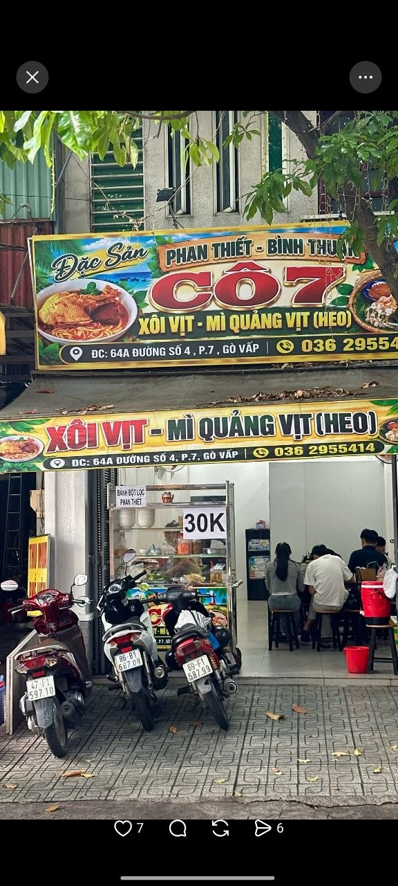
* **Địa chỉ:** 64A Đường số 4, Phường 7, Quận Gò Vấp, TP.HCM
* **Hotline:** 0362955414
* **Món chính / Must-try:** Xôi Vịt, Mì Quảng Vịt, Mì Quảng Heo, Bánh bột lọc Phan Thiết
* **Giá cả:** 30.000 VNĐ
* **Đánh giá & Điểm nổi bật:** Quán bình dân đặc sản Phan Thiết - Bình Thuận, xôi dẻo thịt vịt mềm, mì quảng vịt/heo chuẩn vị, bánh bột lọc dai ngon niêm yết đồng giá 30k.
* **Nguồn review & Link bài viết:** [Threads / Ảnh gửi](https://www.threads.net)
* **Tags:** `#Gò Vấp`, `#Ăn sáng`, `#Ăn trưa`, `#Xôi vịt`, `#Mì Quảng`, `#Bình dân`, `#Phan Thiết`

---

## 2. Bún Chả Hà Nội & Bánh Cuốn Thịt Nướng (tuiminhbanbuncha.29) (Quận 12)
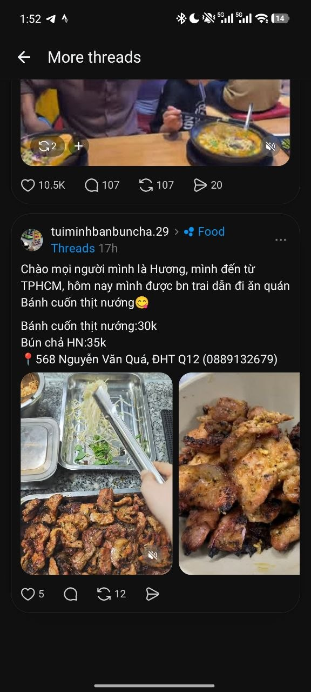
* **Địa chỉ:** 568 Nguyễn Văn Quá, P. Đông Hưng Thuận, Quận 12, TP.HCM (giáp Gò Vấp)
* **Hotline:** 0889132679
* **Món chính / Must-try:** Bún chả Hà Nội, Bánh cuốn thịt nướng
* **Giá cả:** 30.000 - 35.000 VNĐ
* **Đánh giá & Điểm nổi bật:** Bánh cuốn thịt nướng thơm nức 30k, bún chả Hà Nội nướng than chả viên thơm mềm nước mắm pha chua ngọt thanh 35k.
* **Nguồn review & Link bài viết:** [Threads (@tuiminhbanbuncha.29)](https://www.threads.net/@tuiminhbanbuncha.29)
* **Tags:** `#Quận 12`, `#Gần Gò Vấp`, `#Bún chả`, `#Bánh cuốn`, `#Bình dân`

---

## 3. Cơm Tấm Đêm 6 Tèo (Gò Vấp)

* **Địa chỉ:** 400 Phan Văn Trị, Phường 7, Quận Gò Vấp, TP.HCM
* **Món chính / Must-try:** Cơm tấm sườn nướng, Sườn bì chả trứng ốp la, Lạp xưởng
* **Giá cả:** 35.000 - 55.000 VNĐ
* **Đánh giá & Điểm nổi bật:** Quán cơm tấm đêm siêu đông khách, sườn ướp đậm đà nướng than thơm lừng không bị khô, nước mắm kẹo bắt miệng, phục vụ nhanh.
* **Nguồn review & Link bài viết:** [Threads / MXH Food Review](https://www.lemon8-app.com/@saigon_angi27590/7682637121236107794)
* **Tags:** `#Gò Vấp`, `#Cơm tấm`, `#Ăn đêm`, `#Phan Văn Trị`

---

## 4. Ốc Lắc Cô Mai (Gò Vấp)
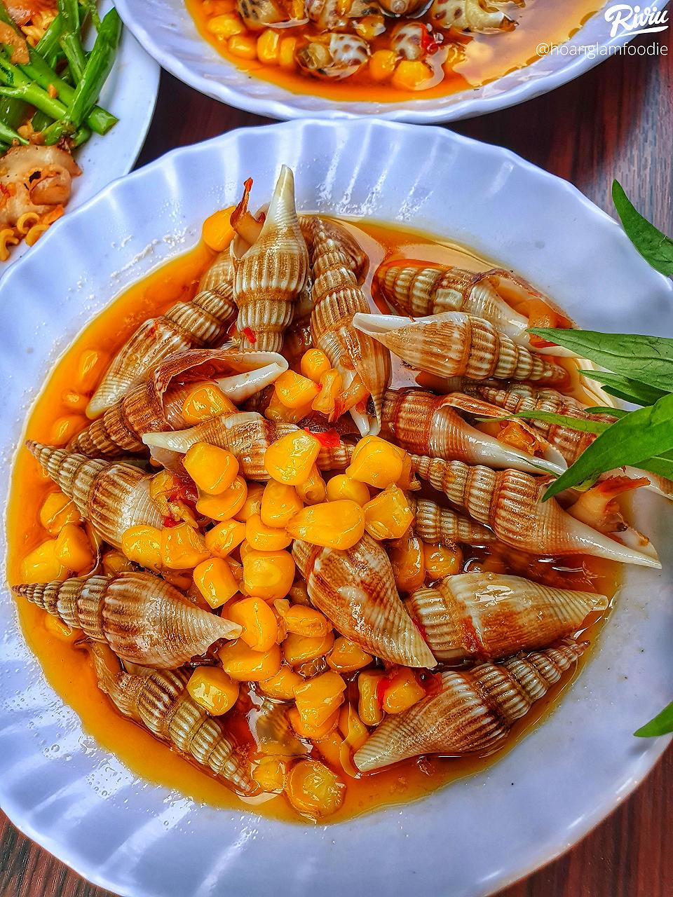
* **Địa chỉ:** Hẻm 36/14 Thoại Ngọc Hầu / Núp hẻm Quang Trung, Quận Gò Vấp, TP.HCM
* **Món chính / Must-try:** Ốc lắc sốt phô mai, Ốc hương sốt trứng muối, Càng ghẹ rang muối
* **Giá cả:** 40.000 - 90.000 VNĐ
* **Đánh giá & Điểm nổi bật:** Quán ốc núp hẻm có view sân thượng cực chill, hải sản tươi ngon đậm đà, nhân viên nhiệt tình, đông khách vào chiều tối.
* **Nguồn review & Link bài viết:** [Threads / TopTop](https://www.lemon8-app.com/@naominhcunglan_/7188094721783366146)
* **Tags:** `#Gò Vấp`, `#Ốc`, `#Sân thượng`, `#Tụ tập bạn bè`

---

## 5. Lẩu Ếch Sáu Hiếu (Gò Vấp)
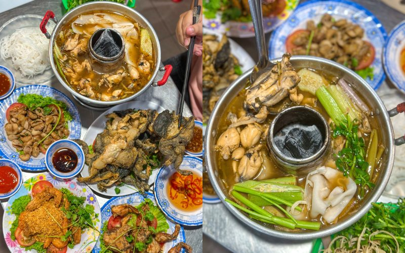
* **Địa chỉ:** 429/9 Quang Trung, Phường 10, Quận Gò Vấp, TP.HCM
* **Món chính / Must-try:** Lẩu ếch măng cay, Da ếch chiên giòn, Ếch xào lăn
* **Giá cả:** 100.000 - 200.000 VNĐ
* **Đánh giá & Điểm nổi bật:** Thương hiệu lẩu ếch trứ danh Gò Vấp, da ếch chiên giòn rụm béo thơm, lẩu măng cay chua ngọt vừa miệng cực kỳ đông khách.
* **Nguồn review & Link bài viết:** [Cộng đồng ẩm thực Gò Vấp](https://toplist.vn/top-list/quan-lau-ech-ngon-re-duoc-yeu-thich-nhat-tai-tp-hcm-46512.htm)
* **Tags:** `#Gò Vấp`, `#Lẩu ếch`, `#Quang Trung`, `#Gia đình`, `#Hội nhóm`

---

## 6. Chân Gà Sốt Thái Cô Minh (Gò Vấp)
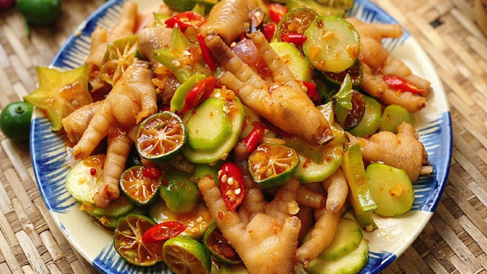
* **Địa chỉ:** 305 Nguyễn Văn Khối (Cây Trâm cũ), Phường 9, Quận Gò Vấp, TP.HCM
* **Món chính / Must-try:** Chân gà rút xương sốt Thái, Tai heo sốt Thái
* **Giá cả:** 60.000 - 100.000 VNĐ
* **Đánh giá & Điểm nổi bật:** Xe chân gà nổi tiếng cõi mạng; sốt Thái đặc sệt thơm cay tê, chân gà rút xương giòn sần sật thấm đều gia vị (bán từ 15h đến hết).
* **Nguồn review & Link bài viết:** [Threads / TikTok viral](https://www.lemon8-app.com/theotheoriviu/7239231897677595137)
* **Tags:** `#Gò Vấp`, `#Ăn vặt`, `#Chân gà sốt Thái`, `#Nguyễn Văn Khối`

---

## 7. Bún Riêu 336 Nguyễn Văn Lượng (Gò Vấp)
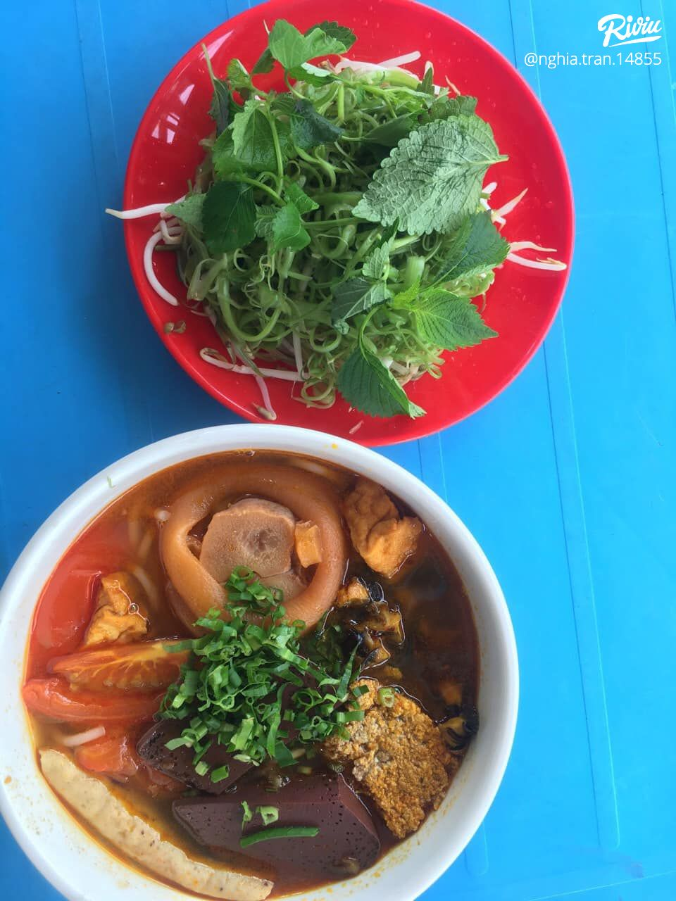
* **Địa chỉ:** 336 Nguyễn Văn Lượng, Phường 16, Quận Gò Vấp, TP.HCM (đối diện Lotte Mart)
* **Món chính / Must-try:** Bún riêu cua ốc thập cẩm, Chả lụa, Chả tiêu
* **Giá cả:** 20.000 - 35.000 VNĐ
* **Đánh giá & Điểm nổi bật:** Tô thập cẩm 35k đầy ụ thịt thà, riêu cua thơm lừng, ốc giòn, nước lèo ngọt thanh đậm đà, bán từ 6h sáng đến 14h trưa.
* **Nguồn review & Link bài viết:** [Review ẩm thực](https://www.momo.vn/page/9814046)
* **Tags:** `#Gò Vấp`, `#Bún riêu`, `#Ăn sáng`, `#Giá rẻ`

---

## 8. Bún Cá Rô Đồng Hoàng Cúc (Gò Vấp)

* **Địa chỉ:** 236 Nguyễn Oanh, Phường 17, Quận Gò Vấp, TP.HCM
* **Món chính / Must-try:** Bún cá rô đồng chiên giòn, Bún cá rô hấp, Măng cay
* **Giá cả:** 35.000 - 55.000 VNĐ
* **Đánh giá & Điểm nổi bật:** Thịt cá rô đồng lọc xương chiên vàng giòn thơm nức, nước dùng cá ngọt thanh tự nhiên ăn kèm rau cần, cải mầm và măng chua ngâm giòn.
* **Nguồn review & Link bài viết:** [Foody / Người dân địa phương](https://vntopfood.com/bun-ca-go-vap/)
* **Tags:** `#Gò Vấp`, `#Bún cá rô`, `#Nguyễn Oanh`, `#Thanh đạm`

---

## 9. Lẩu Dê SOS Làng Hoa (20 năm) (Gò Vấp)
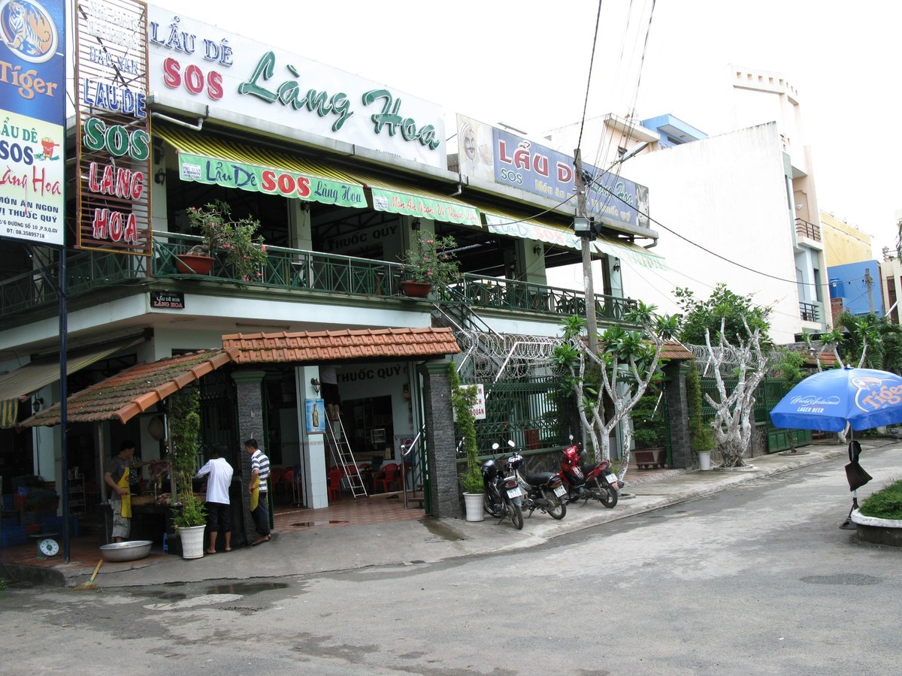
* **Địa chỉ:** 108/6 Nguyễn Văn Khối, Phường 9, Quận Gò Vấp, TP.HCM
* **Món chính / Must-try:** Lẩu dê nhúng, Dê nướng mọi, Vú dê nướng, Dê hấp tía tô
* **Giá cả:** 150.000 - 300.000 VNĐ
* **Đánh giá & Điểm nổi bật:** Hơn 20 năm tuổi trứ danh làng hoa Gò Vấp, thịt dê tươi không hôi, chao chấm béo cay mặn mà, nước lẩu thảo mộc thơm bổ dưỡng.
* **Nguồn review & Link bài viết:** [Review ẩm thực Sài Gòn](https://www.bachhoaxanh.com/kinh-nghiem-hay/5-quan-lau-sieu-ngon-ban-lau-nam-ma-dan-go-vap-thuong-ghe-1314109)
* **Tags:** `#Gò Vấp`, `#Lẩu dê`, `#Lâu đời`, `#Hội họp`

---

## 10. Phá Lấu Bò Cây Trâm (Gò Vấp)
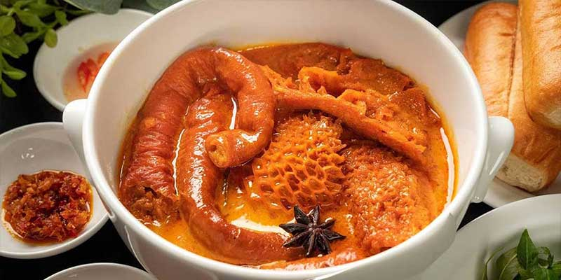
* **Địa chỉ:** 208 Cây Trâm (Nguyễn Văn Khối), Phường 8, Quận Gò Vấp, TP.HCM
* **Món chính / Must-try:** Phá lấu chén, Mì gói phá lấu, Bánh mì phá lấu
* **Giá cả:** 25.000 - 40.000 VNĐ
* **Đánh giá & Điểm nổi bật:** Lòng bò làm sạch kĩ không mùi, nước cốt dừa béo ngọt vừa vặn, nước mắm me chua cay chấm siêu dính, bánh mì luôn giòn rụm.
* **Nguồn review & Link bài viết:** [Food review](https://trangvangamthuc.com/pha-lau-bo-cay-tram/)
* **Tags:** `#Gò Vấp`, `#Phá lấu bò`, `#Ăn vặt xế chiều`

---

## 11. Ngõ Thái (Gò Vấp)
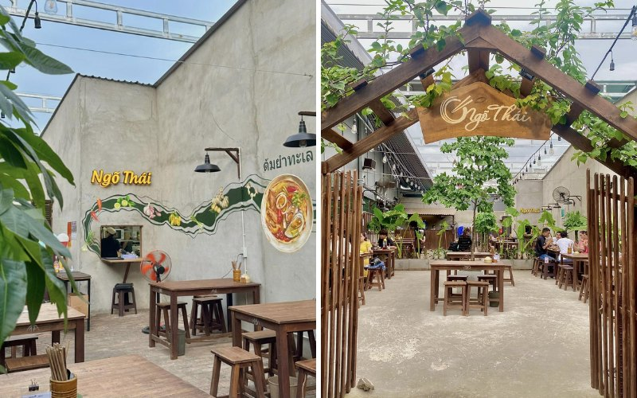
* **Địa chỉ:** 945/64B Lê Đức Thọ, Phường 16, Quận Gò Vấp, TP.HCM
* **Món chính / Must-try:** Sườn cây tắm ớt hiểm, Cà ri hải sản xanh, Gỏi xoài cá trê, Xôi xoài
* **Giá cả:** 50.000 - 120.000 VNĐ
* **Đánh giá & Điểm nổi bật:** Quán món Thái núp hẻm ấm cúng giá cực kỳ 'hạt dẻ' so với nhà hàng; món sườn cây ớt hiểm chuẩn vị cay nồng, nên đặt bàn trước sau 18h.
* **Nguồn review & Link bài viết:** [Threads / Food review](https://angiday.me/do-an-kieu-thai-ngo-thai)
* **Tags:** `#Gò Vấp`, `#Món Thái`, `#Sườn cây`, `#Núp hẻm`

---

## 12. Bò Bít Tết Củ Hành Tây (Gò Vấp) (Gò Vấp)
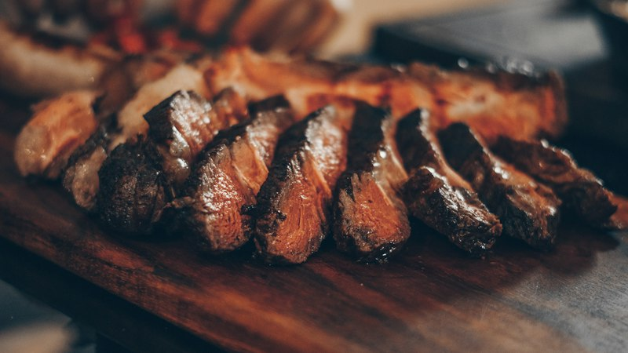
* **Địa chỉ:** 393 - 395 Lê Quang Định, P.5 & 189 Nguyễn Oanh, P.17, Gò Vấp, TP.HCM
* **Hotline:** 028 3515 0524
* **Món chính / Must-try:** Bít tết thập cẩm (bò, pate, trứng ốp la, xíu mại, phô mai), Bò sốt tiêu đen, Bánh mì nóng giòn, Salad dầu giấm
* **Giá cả:** 65.000 - 120.000 VNĐ
* **Đánh giá & Điểm nổi bật:** Quán bít tết lâu năm nức tiếng Gò Vấp, thịt bò ướp mềm đậm vị không bị dai, chảo gang nóng xèo xèo, không gian máy lạnh sạch sẽ, phục vụ rất nhanh.
* **Nguồn review & Link bài viết:** [Review ẩm thực Sài Gòn / Foody](https://www.foody.vn/ho-chi-minh/bo-cu-hanh-tay-le-quang-dinh)
* **Tags:** `#Gò Vấp`, `#Bò bít tết`, `#Củ Hành Tây`, `#Lê Quang Định`, `#Nguyễn Oanh`, `#Ăn tối`

---

## 13. Beefsteak TiTi (Phan Văn Trị) (Gò Vấp)
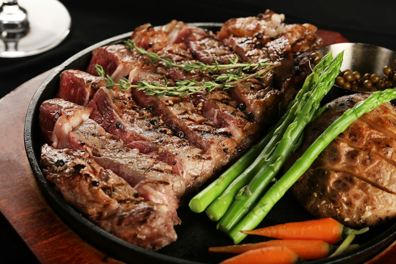
* **Địa chỉ:** 467 Phan Văn Trị, Phường 5, Quận Gò Vấp, TP.HCM (gần Emart)
* **Hotline:** 090 274 72 73
* **Món chính / Must-try:** Bò Mỹ sốt tiêu đen, Bò sốt phô mai cay, Khoai tây nghiền, Salad cá ngừ
* **Giá cả:** 90.000 - 180.000 VNĐ
* **Đánh giá & Điểm nổi bật:** Không gian ấm cúng, sang trọng vừa phải rất hợp hẹn hò hoặc ăn gia đình; thịt bò mềm mọng nước có thể chọn độ chín (Medium-rare/Medium), sốt tiêu và phô mai béo thơm đặc trưng.
* **Nguồn review & Link bài viết:** [Foody / Riviu Beefsteak](https://www.foody.vn/ho-chi-minh/beefsteak-titi-phan-van-tri)
* **Tags:** `#Gò Vấp`, `#Beefsteak`, `#TiTi`, `#Phan Văn Trị`, `#Hẹn hò`, `#Gia đình`

---

## 14. Bò Bít Tết Hỏa Xa (Gò Vấp)
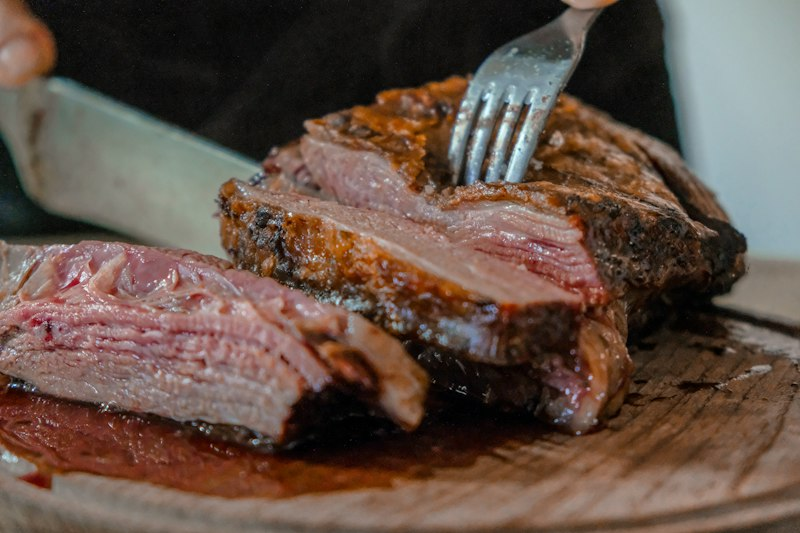
* **Địa chỉ:** 168 Phan Văn Trị, Phường 10, Quận Gò Vấp, TP.HCM
* **Món chính / Must-try:** Bít tết chảo gang truyền thống, Bò né thập cẩm, Bắp bò lúc lắc
* **Giá cả:** 45.000 - 85.000 VNĐ
* **Đánh giá & Điểm nổi bật:** Bít tết phong cách truyền thống bình dân mở lâu năm; pate béo bùi, nước sốt sệt chấm bánh mì cực cuốn, giá bình dân.
* **Nguồn review & Link bài viết:** [Cộng đồng ẩm thực Gò Vấp](https://www.foody.vn/ho-chi-minh/bit-tet-hoa-xa)
* **Tags:** `#Gò Vấp`, `#Bò bít tết`, `#Hỏa Xa`, `#Phan Văn Trị`, `#Bình dân`

---

## 15. Bò Bít Tết & Bò Né 3 Ngon (Gò Vấp)
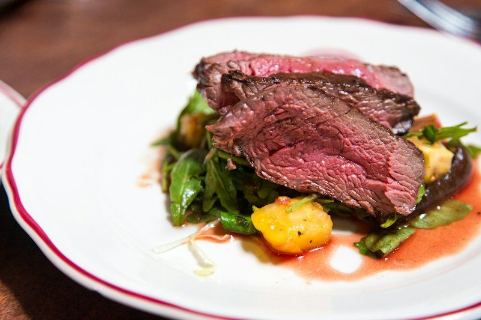
* **Địa chỉ:** 484 Lê Văn Thọ, Phường 16, Quận Gò Vấp, TP.HCM
* **Món chính / Must-try:** Chảo bò né thập cẩm đặc biệt, Bò bít tết phô mai, Xúc xích trứng ốp la
* **Giá cả:** 35.000 - 65.000 VNĐ
* **Đánh giá & Điểm nổi bật:** Chuỗi bò né bình dân giá sinh viên quen thuộc; chảo gang sôi bùng khói thơm phức, phục vụ nhanh, ăn sáng hay ăn tối đều tiện.
* **Nguồn review & Link bài viết:** [Địa điểm ăn uống Gò Vấp](https://www.foody.vn/ho-chi-minh/3-ngon-bo-ne-le-van-tho)
* **Tags:** `#Gò Vấp`, `#Bò né`, `#3 Ngon`, `#Lê Văn Thọ`, `#Giá rẻ`

---

## 16. Bánh Mì Chảo Cô 3 Hậu (Gò Vấp)
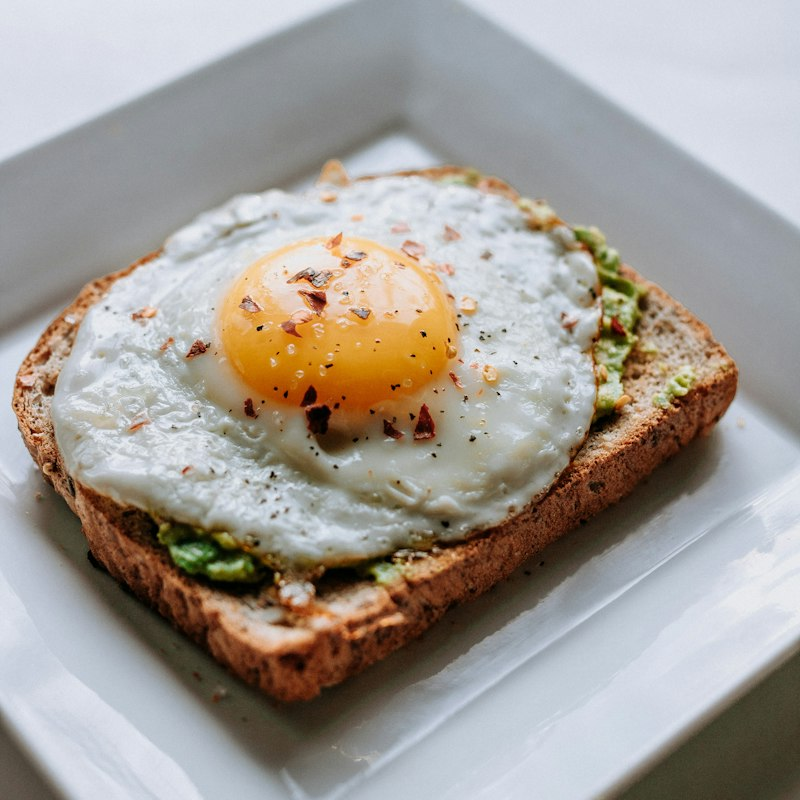
* **Địa chỉ:** 36 Đường Số 18, Phường 8, Quận Gò Vấp, TP.HCM
* **Hotline:** 093 782 54 44
* **Món chính / Must-try:** Bánh mì chảo thập cẩm (pate, xíu mại, ốp la, xúc xích, phô mai), Bánh mì bò xào, Sữa đậu nành
* **Giá cả:** 25.000 - 45.000 VNĐ
* **Đánh giá & Điểm nổi bật:** Quán bánh mì chảo đông nức tiếng Gò Vấp với hàng nghìn lượt đánh giá thật; chảo sốt cà chua thịt băm sánh sệt đậm đà, pate nhà làm béo ngậy không ngấy, bánh mì lúc nào cũng nóng giòn rụm.
* **Nguồn review & Link bài viết:** [Review cộng đồng Gò Vấp / Foody](https://www.foody.vn/ho-chi-minh/banh-mi-chao-co-3-hau)
* **Tags:** `#Gò Vấp`, `#Bánh mì chảo`, `#Cô 3 Hậu`, `#Đường số 18`, `#Đông khách`, `#Ăn sáng`

---

## 17. Nhà Hàng Ẩm Thực Những Người Bạn (Gò Vấp)
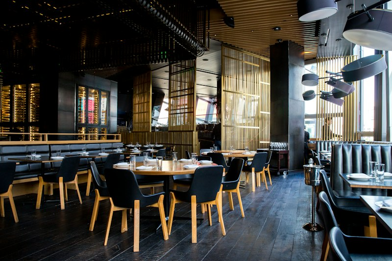
* **Địa chỉ:** 14 Phan Văn Trị, Phường 7, Quận Gò Vấp, TP.HCM
* **Hotline:** 028 3588 5888
* **Món chính / Must-try:** Heo tộc quay lu mẹt, Cá lăng nướng muối ớt / nấu măng chua, Gà ta hấp mắm nhĩ, Lẩu riêu cua bắp bò
* **Giá cả:** 150.000 - 350.000 VNĐ
* **Đánh giá & Điểm nổi bật:** Nhà hàng sân vườn quy mô lớn và uy tín bậc nhất Gò Vấp (>4.000 đánh giá Google Maps ~4.5 sao); không gian rợp cây xanh thoáng đãng, hải sản và đặc sản đồng quê tươi rói, chế biến ngon miệng và ổn định lâu năm.
* **Nguồn review & Link bài viết:** [Google Maps / Đánh giá ẩm thực Sài Gòn](https://www.foody.vn/ho-chi-minh/nhung-nguoi-ban-am-thuc-san-vuon)
* **Tags:** `#Gò Vấp`, `#Ẩm thực sân vườn`, `#Gia đình`, `#Họp mặt`, `#Phan Văn Trị`, `#Hải sản`

---

## 18. Gà Nướng Cái Bang (Quang Trung) (Gò Vấp)
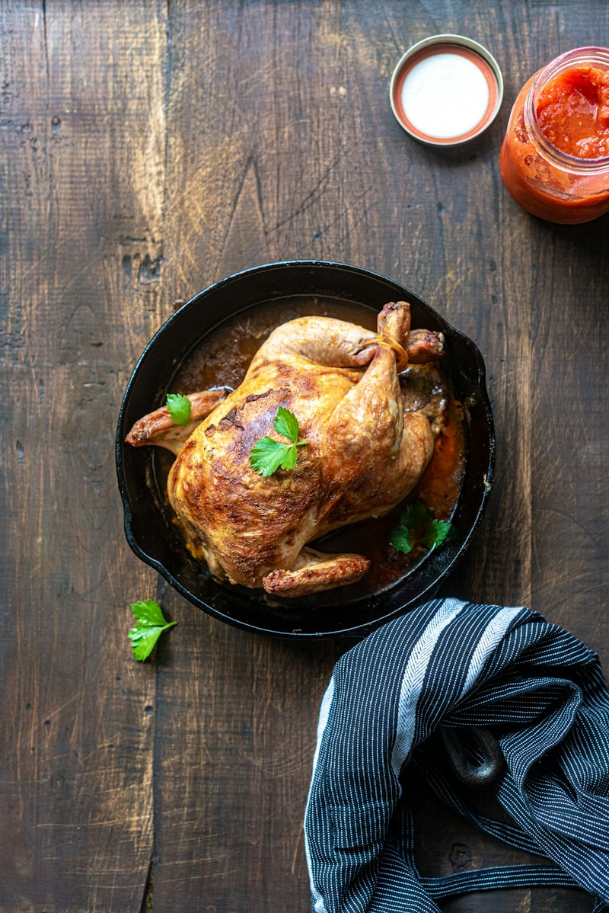
* **Địa chỉ:** 181 Quang Trung, Phường 10, Quận Gò Vấp, TP.HCM
* **Hotline:** 090 988 51 68
* **Món chính / Must-try:** Gà nướng muối ớt xanh, Gà nướng ngũ vị, Xôi chiên phồng giòn, Chân gà quái thú
* **Giá cả:** 120.000 - 220.000 VNĐ / con
* **Đánh giá & Điểm nổi bật:** Thương hiệu gà nướng phong cách cổ trang cực kỳ đông khách; thịt gà ta thả vườn dai ngọt nướng vàng óng da giòn, sốt ướp thấm sâu vào từng thớ thịt, chấm muối ớt xanh chua cay bắt vị.
* **Nguồn review & Link bài viết:** [Review ẩm thực thực tế](https://www.foody.vn/ho-chi-minh/ga-nuong-cai-bang-quang-trung)
* **Tags:** `#Gò Vấp`, `#Gà nướng`, `#Cái Bang`, `#Quang Trung`, `#Tụ tập bạn bè`

---

## 19. Bánh Cuốn Tây Sơn Cô 2 (Đặc Sản Bình Định) (Gò Vấp)
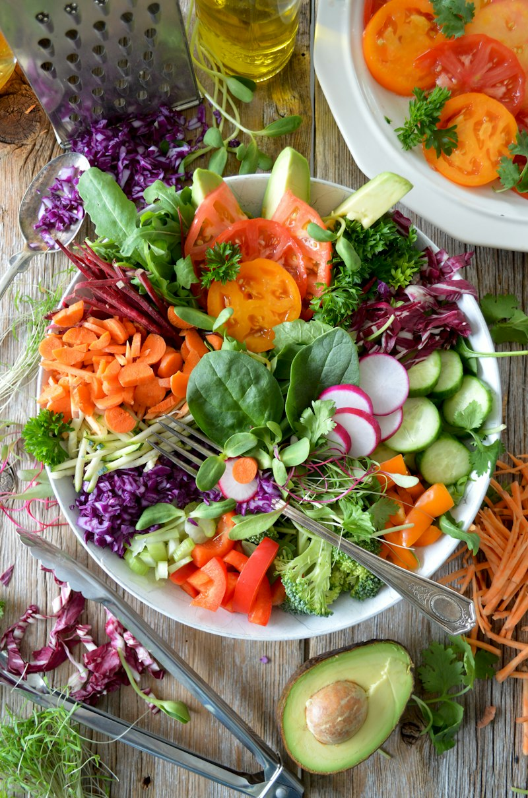
* **Địa chỉ:** 346 Nguyễn Thái Sơn, Phường 5, Quận Gò Vấp, TP.HCM
* **Hotline:** 090 912 34 56
* **Món chính / Must-try:** Bánh cuốn Tây Sơn cỡ đại (chả ram giòn, nem chua, trứng, thịt lụi), Bánh bèo chén Bình Định, Chả ram tôm đất
* **Giá cả:** 15.000 - 35.000 VNĐ
* **Đánh giá & Điểm nổi bật:** Quán vỉa hè lúc nào cũng đông nghẹt khách; bánh cuốn to đùng gói chả ram giòn rụm bên trong, chấm cùng nước sốt đậu phộng thịt xay béo bùi chuẩn vị xứ võ Tây Sơn.
* **Nguồn review & Link bài viết:** [Review ẩm thực đường phố / MXH](https://www.foody.vn/ho-chi-minh/banh-cuon-tay-son-co-2)
* **Tags:** `#Gò Vấp`, `#Bánh cuốn Tây Sơn`, `#Nguyễn Thái Sơn`, `#Đặc sản Bình Định`, `#Bình dân`

---

## 20. Dalatown - Bánh Căn & Bánh Tráng Nướng Đà Lạt (Gò Vấp)
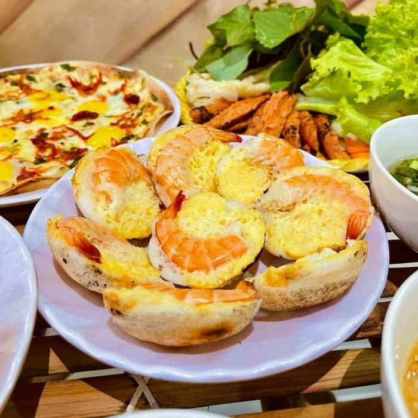
* **Địa chỉ:** 448 Lê Văn Thọ, Phường 16, Quận Gò Vấp, TP.HCM
* **Hotline:** 0985 796 948
* **Món chính / Must-try:** Bánh căn trứng cút lòng đào xíu mại, Bánh căn trứng gà, Bánh tráng nướng Đà Lạt giòn rụm, Nem nướng & Trà atiso
* **Giá cả:** 30.000 - 65.000 VNĐ
* **Đánh giá & Điểm nổi bật:** Góc ẩm thực mang trọn không khí và phong vị Đà Lạt về Gò Vấp. Bánh căn đổ khuôn đất giòn rụm vỏ ngoài mềm xốp bên trong ăn cùng chén xíu mại bốc khói béo bùi, nước mắm nêm thanh dịu hoặc mắm ngọt tự chọn cực kỳ cuốn.
* **Nguồn review & Link bài viết:** [Threads & Tripi Review (Top Bánh Căn Sài Gòn)](https://tripi.vn/blog/vi/xep-hang/14-dia-chi-banh-can-dam-vi-niu-chan-thuc-khach-tai-sai-gon-tripi)
* **Tags:** `#Gò Vấp`, `#Bánh căn`, `#Đà Lạt`, `#Bánh tráng nướng`, `#Xíu mại`, `#Ăn vặt`, `#Lê Văn Thọ`

---

## 21. Bún Cay Thái 2 Thuận - Nguyễn Văn Khối (Gò Vấp)
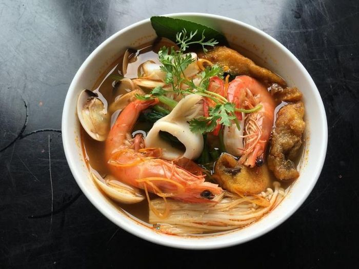
* **Địa chỉ:** 320 Nguyễn Văn Khối (Cây Trâm cũ), Phường 9, Quận Gò Vấp, TP.HCM
* **Hotline:** 0929 233 114
* **Món chính / Must-try:** Bún Thái chua cay hải sản thập cẩm, Bún hải sản mực giòn tôm sú bò Mỹ, Trà tắc giải nhiệt khổng lồ
* **Giá cả:** 35.000 - 55.000 VNĐ
* **Đánh giá & Điểm nổi bật:** Tô bún Thái chua cay nóng hổi đậm đà hương sả lá chanh với nước dùng ngọt thanh từ xương tôm. Topping hào phóng ngập tràn tôm sú tươi ngọt, mực giòn sần sật và thịt bò mềm, cực kỳ bắt vị trong những ngày mưa mát mẻ.
* **Nguồn review & Link bài viết:** [Threads, Lemon8 & Tripi/LUG Review](https://tripi.vn/blog/vi/am-thuc/9-diem-den-bun-hai-san-ngon-binh-dan-khong-the-bo-qua-tai-sai-gon-tripi)
* **Tags:** `#Gò Vấp`, `#Bún Thái`, `#Bún cay`, `#Hải sản`, `#Nguyễn Văn Khối`, `#Bình dân`

---

## 22. Bếp Ông Lập - Bún Bò Thố Đá & Bò Kho Xuyên Tiêu (Gò Vấp)
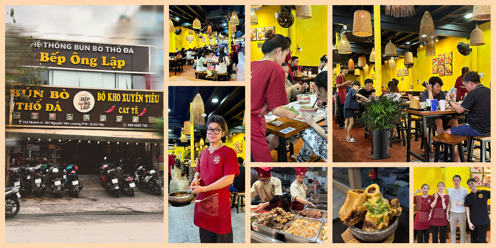
* **Địa chỉ:** 301 Nguyễn Văn Lượng, Phường 10, Quận Gò Vấp, TP.HCM
* **Hotline:** 0986 565 788 / 1900 999 973
* **Món chính / Must-try:** Bún bò thố đá sườn sụn / đuôi bò, Bún bò đặc biệt thố đá, Bò kho xuyên tiêu cay nồng, Lẩu bò nhúng mắm ruốc
* **Giá cả:** 45.000 - 85.000 VNĐ
* **Đánh giá & Điểm nổi bật:** Quán bún bò thố đá trứ danh cực đông khách tại Gò Vấp; nước dùng đựng trong thố đá sôi sùng sục giữ nóng hổi đến giọt cuối cùng, nước hầm thanh ngọt tự nhiên, thịt bắp bò mềm ngậy ăn kèm mắm ruốc chấm pha riêng thơm nức mũi.
* **Nguồn review & Link bài viết:** [Bếp Ông Lập & MXH Ẩm Thực](https://beponglap.vn/bep-ong-lap-chieu-dai-thuc-khach-mon-bun-bo-tho-da-tru-danh-va-bo-kho-xuyen-tieu-gay-nghien-tai-go-vap)
* **Tags:** `#Gò Vấp`, `#Bún bò thố đá`, `#Bếp Ông Lập`, `#Nguyễn Văn Lượng`, `#Ăn sáng`, `#Ăn trưa`, `#Ăn tối`

---

## 23. GAPHUNG JUMAK - Korean Pub & Quán Ăn Hàn Quốc (가풍주막) (Gò Vấp)
* **Địa chỉ:** 113 Nguyễn Văn Lượng, Phường 17, Quận Gò Vấp, TP.HCM
* **Hotline:** 038 219 8676
* **Món chính / Must-try:** Bánh xèo Hàn Quốc giòn rụm (Kimchijeon / Pajeon), Canh kim chi thịt heo hầm (Kimchi Jjigae), Gà sốt tỏi cay ngọt, Rượu gạo Makgeolli & Soju
* **Giá cả:** 60.000 - 180.000 VNĐ
* **Đánh giá & Điểm nổi bật:** Không gian pub nhậu chuẩn Hàn ấm cúng do chính chủ người Hàn đứng bếp tại Gò Vấp; món ăn chuẩn vị nguyên bản không bị lai ngọt, panchan đầy đặn, cực kỳ lý tưởng để họp mặt bạn bè lai rai buổi tối.
* **Nguồn review & Link bài viết:** [Threads & Review Ẩm Thực Sài Gòn (Mecrawl / LocalVietnam)](https://mecrawl.com/en/places/go-vaps-quiet-korean-star-inside-gaphung-jumak-a_01m2d8caepvvcexvtefzw85w4k)
* **Tags:** `#Gò Vấp`, `#Món Hàn`, `#Korean Pub`, `#Gaphung Jumak`, `#Nguyễn Văn Lượng`, `#Ăn tối`, `#Tụ tập bạn bè`

---

## 24. Mì Vịt Tiềm A Cón (Gò Vấp)
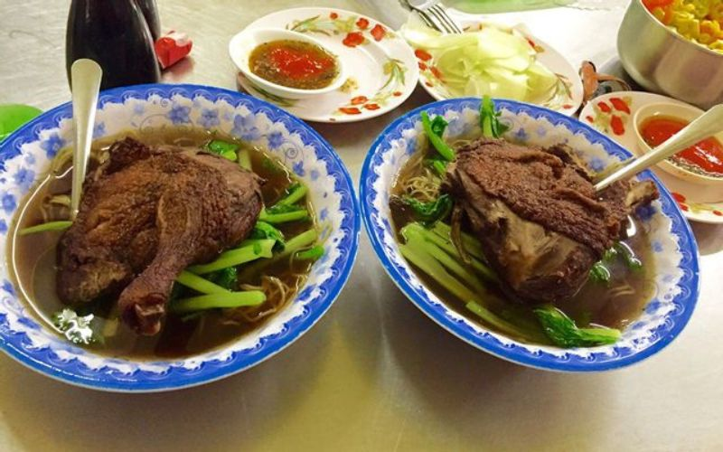
* **Địa chỉ:** 557 Quang Trung, Phường 10, Quận Gò Vấp, TP.HCM
* **Hotline:** 028 3894 1358
* **Món chính / Must-try:** Mì vịt tiềm đùi góc tư (chiên giòn hoặc tiềm mềm), Mì sủi cảo tôm thịt, Mì xào giòn đồ biển, Hoành thánh chiên giòn
* **Giá cả:** 65.000 - 110.000 VNĐ
* **Đánh giá & Điểm nổi bật:** Tiệm mì tiềm người Hoa lâu năm nức tiếng trên trục đường Quang Trung. Đùi vịt góc tư hầm thuốc bắc mềm rục ngọt thịt, da vịt chiên vàng thơm không hôi ngấy, nước dùng thảo mộc thanh ngọt đậm đà, sợi mì trứng vàng tươi dai sần sật ăn kèm đu đủ ngâm chua giòn giải ngấy.
* **Nguồn review & Link bài viết:** [Wanderlog & Bách Hóa XANH / Kingfoodmart](https://wanderlog.com/place/details/1082937/m%C3%AC-v%E1%BB%8Bt-ti%E1%BB%81m-a-c%C3%B3n)
* **Tags:** `#Gò Vấp`, `#Món Hoa`, `#Mì vịt tiềm`, `#Quang Trung`, `#A Cón`, `#Ăn tối`, `#Lâu đời`

---

## 25. Bánh Mì Nướng Campuchia Bayon (Gò Vấp)
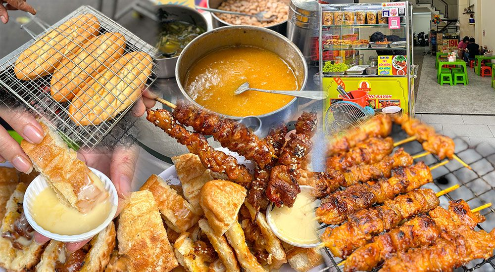
* **Địa chỉ:** 368/10c Nguyễn Văn Lượng, Phường 10, Quận Gò Vấp, TP.HCM
* **Món chính / Must-try:** Bánh mì nướng bơ chà bông Campuchia, Xiên thịt nướng sốt Campuchia mềm mọng, Bánh hỏi thịt nướng than, Sốt bơ chấm béo mặn đặc biệt
* **Giá cả:** 25.000 - 50.000 VNĐ
* **Đánh giá & Điểm nổi bật:** Quán ăn vặt từng gây sốt rần rần trên TikTok/Threads tại khu Nguyễn Văn Lượng. Bánh mì quết bơ chà bông nướng than giòn rụm thơm lừng, thịt xiên nướng than hoa mềm mọng nước không bị khô, chấm cùng chén sốt bơ béo ngậy mằn mặn và đồ chua chống ngấy cực đỉnh.
* **Nguồn review & Link bài viết:** [Threads & TikTok ẩm thực (DiDau Review)](https://didau.com/qua-chat-luong-b-nh-mi-nuong-campuchia-duoc-cac-tiktoker-giai-cuu-ban-khong-kip-tho-o-go-vap)
* **Tags:** `#Gò Vấp`, `#Ăn vặt`, `#Bánh mì nướng`, `#Campuchia`, `#Nguyễn Văn Lượng`, `#Xiên nướng`, `#Hot TikTok`

---

## 26. Bò Lá Lốt Anh Ba (Phú Nhuận)

* **Địa chỉ:** 460 Phan Xích Long, Phường 2, Quận Phú Nhuận, TP.HCM
* **Hotline:** 090 333 3333
* **Món chính / Must-try:** Bò lá lốt nướng than hoa, Bò mỡ chài béo ngậy nướng giòn, Bánh hỏi bò lá lốt mỡ hành đậu phộng, Mắm nêm pha dứa chua cay đậm đà
* **Giá cả:** 35.000 - 80.000 VNĐ
* **Đánh giá & Điểm nổi bật:** Quán bò lá lốt trứ danh nức tiếng khu phố ẩm thực Phan Xích Long (Phú Nhuận). Bò cuốn lá lốt nướng than hoa thơm lừng cả con phố, thịt bò mềm mọng không bị khô xác, mỡ chài béo ngậy thơm nức, ăn kèm bánh hỏi/bánh tráng, rau rừng đủ loại và chén mắm nêm đậm đà thơm mùi dứa cay nồng.
* **Nguồn review & Link bài viết:** [Threads & Foody / Riviu](https://www.foody.vn/ho-chi-minh/bo-la-lot-anh-ba-phan-xich-long)
* **Tags:** `#Phú Nhuận`, `#Phan Xích Long`, `#Bò lá lốt`, `#Bò mỡ chài`, `#Ăn tối`, `#Lâu đời`, `#Hot Threads`

---

## 27. Bún Bò Chú Gấu (Gò Vấp)
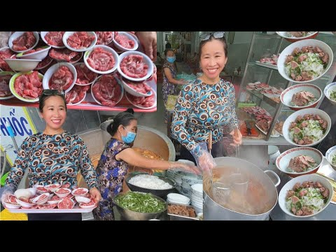
* **Địa chỉ:** 108/4 Nguyễn Văn Lượng, Phường 16, Quận Gò Vấp, TP.HCM
* **Hotline:** Đang cập nhật
* **Món chính / Must-try:** Bún bắp bò hoa giòn sần sật, Bún nạm gân bò trong veo mềm dẻo, Bún sườn bò hầm mềm rục, Nước dùng hầm xương bò thanh ngọt tự nhiên
* **Giá cả:** 40.000 - 65.000 VNĐ
* **Đánh giá & Điểm nổi bật:** Quán bún bò buổi sáng nức tiếng và 'cháy hàng' nhanh nhất khu Nguyễn Văn Lượng (mở từ 6h00, thường hết veo trước 8h30). Tô bún đầy đặn ngập tràn bắp hoa bò thái dày giòn sần sật, nạm gân thơm béo; nước lèo trong veo ngọt thanh tự nhiên từ xương bò hầm chứ không ngọt gắt bột ngọt, chuẩn vị miền Trung.
* **Nguồn review & Link bài viết:** [Cộng đồng ẩm thực Gò Vấp & Foody](https://www.foody.vn/ho-chi-minh/bun-bo-chu-gau)
* **Tags:** `#Gò Vấp`, `#Nguyễn Văn Lượng`, `#Bún bò`, `#Bắp bò hoa`, `#Ăn sáng`, `#Đông khách`, `#Hot Review`

---

## 28. Xỉn Thái Quán (Gò Vấp)
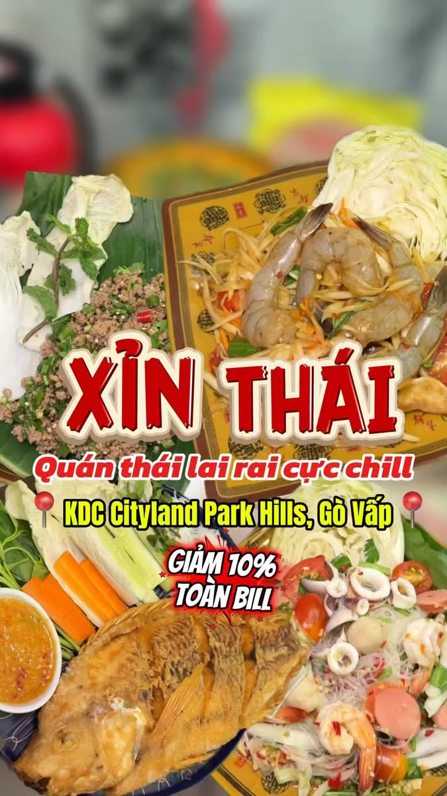
* **Địa chỉ:** 30 Đường Số 10, KDC Cityland Park Hills, Phường 10, Quận Gò Vấp, TP.HCM
* **Hotline:** 0396770444
* **Món chính / Must-try:** Gỏi đu đủ Thái (Som Tum) tôm khô đậu phộng, Bò tiger sốt wasabi (Tiger Beef), Lẩu Thái hải sản / Tomyum, Pad Thái, Sườn nướng tháp, Xôi xoài
* **Giá cả:** 39.000 - 150.000 VNĐ
* **Đánh giá & Điểm nổi bật:** Quán Thái mới mở trong KDC Cityland Park Hills, bếp chính được cho là từ Bangkok nên vị Isaan khá chuẩn và đậm, không bị lai ngọt. Gỏi đu đủ Thái và bò tiger sốt wasabi được khen nhất; không gian mở, quán còn khá vắng nên phục vụ nhanh. Mở khuya 17h - 2h (T6-T7 tới 3h) rất hợp nhậu đêm. Google Maps 4.7/5 nhưng mới ~10 đánh giá nên điểm số chưa thật đại diện.
* **Nguồn review & Link bài viết:** [Google Maps & Cộng đồng ăn uống Gò Vấp](https://www.facebook.com/xinthaiquan)
* **Tags:** `#Gò Vấp`, `#Món Thái`, `#Isaan`, `#Cityland`, `#Ăn khuya`, `#Nhậu`, `#Quán mới`

---

## 29. Ăn Vặt SIMON - Bánh Tráng, Tré Trộn & Chân Gà (Gò Vấp)

* **Địa chỉ:** 638/10 Quang Trung, Phường 11, Quận Gò Vấp, TP.HCM (hẻm đối diện Beta Cinema)
* **Hotline:** 0968873850
* **Món chính / Must-try:** Bánh tráng trộn sa tế tỏi phi, Tré trộn, Chân gà sốt Thái, Bánh mì nướng muối ớt, Cá viên chiên sốt mắm, Bắp xào
* **Giá cả:** 25.000 - 129.000 VNĐ
* **Đánh giá & Điểm nổi bật:** Tọa độ ăn vặt đêm nổi trên TikTok/Lemon8 ở Gò Vấp, mở tới 1h-2h sáng, bàn ghế nhiều màu kiểu canteen nên rất đông nhóm bạn trẻ. Tré trộn đậm đà thấm vị, chân gà sốt Thái cuốn, bánh tráng trộn sa tế tỏi phi thơm; đồ làm tại chỗ, lên món nhanh, giá sinh viên. Lưu ý: chỗ để xe chật, vài review chê nhân viên thái độ và món viên chiên hơi mặn. Google Maps 4.2-4.3/5 (~50 đánh giá).
* **Nguồn review & Link bài viết:** [TikTok / Lemon8 review & Google Maps](https://www.lemon8-app.com/@yourling.ugc/7679257793216446983?region=vn)
* **Tags:** `#Gò Vấp`, `#Quang Trung`, `#Ăn vặt`, `#Ăn khuya`, `#Bánh tráng trộn`, `#Chân gà sốt Thái`, `#Hot TikTok`

---

## 30. Lẩu Gà Lá É Nhật Trường (Bình Lợi - Bình Thạnh)
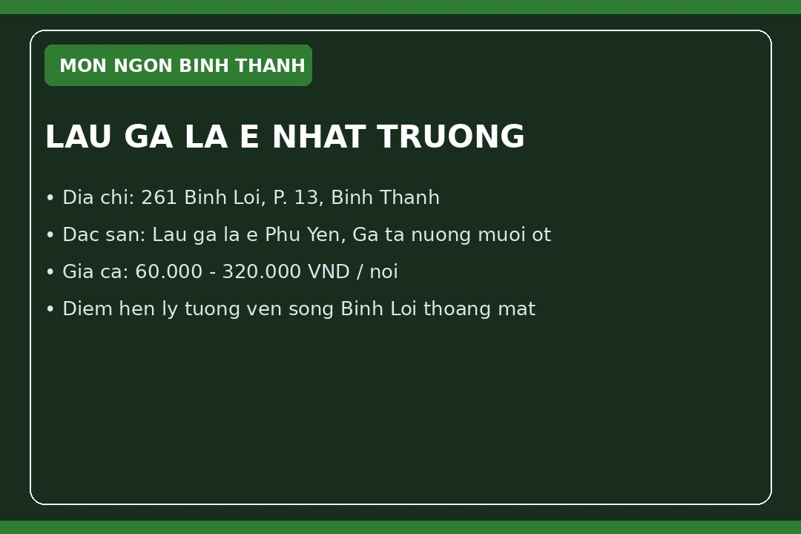
* **Địa chỉ:** 261 Bình Lợi, Phường 13, Quận Bình Thạnh, TP.HCM
* **Hotline:** 0932029707
* **Món chính / Must-try:** Lẩu gà lá é Phú Yên, Gà nướng muối ớt, Gà ta hấp lá chúc, Lòng gà xào mướp
* **Giá cả:** 60.000 - 320.000 VNĐ
* **Đánh giá & Điểm nổi bật:** Quán lẩu gà lá é nức tiếng khu Bình Lợi ven sông thoáng mát. Gà ta thả vườn chắc thịt dai ngọt, nước dùng nấu ngọt thanh từ nước khoáng kết hợp lá é tươi the cay nồng và ớt xiêm xanh cay ấm, nấm bào ngư giòn ngọt. Rất thích hợp cho tụ họp bạn bè, gia đình đổi gió chiều tối.
* **Nguồn review & Link bài viết:** [ShopeeFood & Review ẩm thực Bình Thạnh](https://shopeefood.vn/ho-chi-minh/lau-ga-la-e-nhat-truong-261-binh-loi)
* **Tags:** `#Bình Thạnh`, `#Bình Lợi`, `#Lẩu gà lá é`, `#Gà ta`, `#Nhậu ven sông`, `#Quán mới`

---

## 31. Quán Ốc Năm Nghêu (Nguyễn Gia Trí - Bình Thạnh)
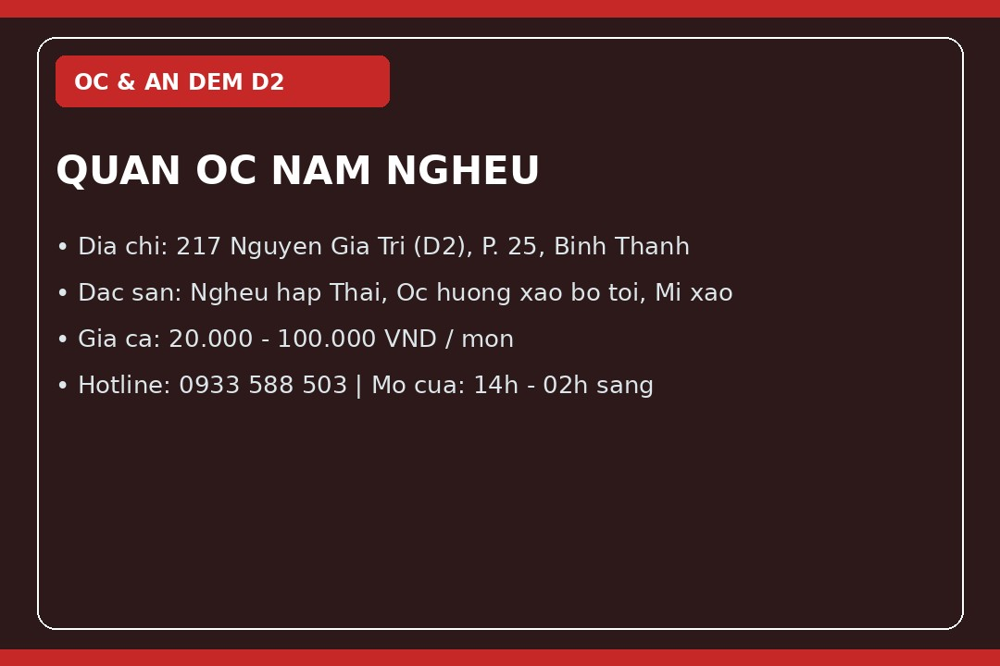
* **Địa chỉ:** 217 Nguyễn Gia Trí (D2 cũ), Phường 25, Quận Bình Thạnh, TP.HCM
* **Hotline:** 0933588503
* **Món chính / Must-try:** Nghêu hấp sả / hấp Thái, Ốc hương xào bơ tỏi, Ốc móng tay xào rau muống, Sò huyết nướng mọi, Mì gói hải sản, Chim cút rôti
* **Giá cả:** 20.000 - 100.000 VNĐ
* **Đánh giá & Điểm nổi bật:** Tụ điểm ăn ốc và nhậu đêm nức tiếng của sinh viên và giới trẻ Bình Thạnh trên con phố ẩm thực D2 Nguyễn Gia Trí. Hải sản tươi sống đa dạng (ốc mỡ, ốc hương, nghêu sò, móng tay) xào nướng đậm đà, nóng hổi tại chỗ. Không gian vỉa hè rộng rãi thoáng mát, mở xuyên đêm tới 2h sáng, giá cực mềm.
* **Nguồn review & Link bài viết:** [Google Maps & Địa điểm ăn uống Bình Thạnh](https://diadiemanuong.net.vn/quan-oc-nam-ngheu-nguyen-gia-tri-binh-thanh-66019/)
* **Tags:** `#Bình Thạnh`, `#Nguyễn Gia Trí`, `#Quán ốc`, `#Hải sản`, `#Ăn khuya`, `#Học sinh sinh viên`, `#Quán mới`

---

## 32. Bánh Canh Cua Gánh Thuý (Hoa Sứ - Phú Nhuận)
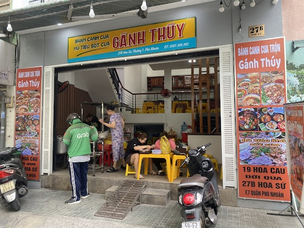
* **Địa chỉ:** 27B Hoa Sứ, Phường 7, Quận Phú Nhuận, TP.HCM
* **Hotline:** 0707389992
* **Món chính / Must-try:** Bánh canh cua trộn (bánh canh khô sốt đặc biệt), Bánh canh cua nước truyền thống thập cẩm, Hoành thánh chiên sốt phô mai, Thịt cua tươi ngọt & chả cua dai giòn
* **Giá cả:** 45.000 - 70.000 VNĐ
* **Đánh giá & Điểm nổi bật:** Quán bánh canh cua nổi đình nổi đám khu phố ẩm thực Phan Xích Long - Hoa Sứ, trưa nào cũng tấp nập thực khách. Điểm nhấn tạo trend là món bánh canh cua trộn khô độc lạ với sợi bánh canh dẻo dai thấm đẫm nước sốt đậm đà, ăn kèm hoành thánh chiên giòn rụm chấm xốt phô mai béo ngậy và chén súp cua ngọt thanh. Không gian sạch sẽ, bảo vệ dắt xe cực kỳ tận tình.
* **Nguồn review & Link bài viết:** [ShopeeFood & TikTok / Food Blogger Review](https://shopeefood.vn/ho-chi-minh/banh-canh-cua-ganh-thuy)
* **Tags:** `#Phú Nhuận`, `#Hoa Sứ`, `#Phan Xích Long`, `#Bánh canh cua`, `#Bánh canh trộn`, `#Ăn trưa`, `#Hot Trend`, `#Quán mới`

---

## 33. Bánh Xèo Rau Rừng A Đạt (Phạm Văn Đồng - Gò Vấp)
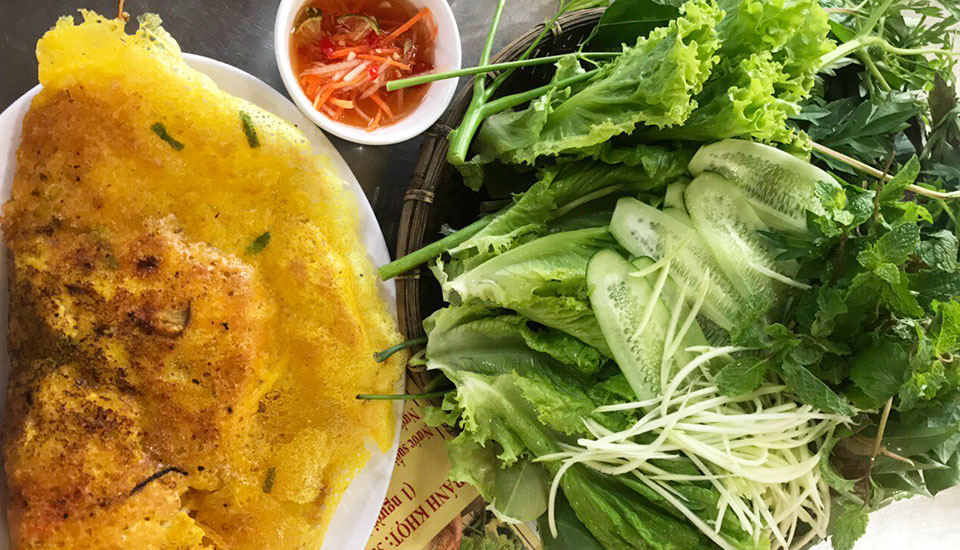
* **Địa chỉ:** 1 Phạm Văn Đồng, Phường 3, Quận Gò Vấp, TP.HCM
* **Hotline:** 0944 670 708
* **Món chính / Must-try:** Bánh xèo tôm thịt giòn rụm, Bánh xèo bắp bò, Bánh khọt tôm tươi vàng ươm, Rổ rau rừng Tây Ninh hơn 10 loại lá tươi mát
* **Giá cả:** 35.000 - 65.000 VNĐ
* **Đánh giá & Điểm nổi bật:** Quán bánh xèo rau rừng quen thuộc nức tiếng ngay đầu trục đường Phạm Văn Đồng (gần vòng xoay Công viên Gia Định). Vỏ bánh đổ mỏng giòn rụm, ráo dầu không bị ngấy, nhân tôm thịt đầy đặn ngọt tươi. Điểm đắt giá nhất là rổ rau rừng Tây Ninh cực phong phú (lá cóc, sao nhái, đọt xoài, lá bứa...) ăn kèm chén nước mắm tỏi ớt pha chua ngọt chuẩn vị miền Tây.
* **Nguồn review & Link bài viết:** [ShopeeFood & Foody Review](https://shopeefood.vn/ho-chi-minh/a-dat-banh-xeo-rau-rung)
* **Tags:** `#Gò Vấp`, `#Phạm Văn Đồng`, `#Bánh xèo`, `#Bánh xèo rau rừng`, `#Bánh khọt`, `#Đặc sản miền Tây`, `#Quán mới`

---

## 34. Bún Mắm Cô Ba (Phan Huy Ích - Gò Vấp)
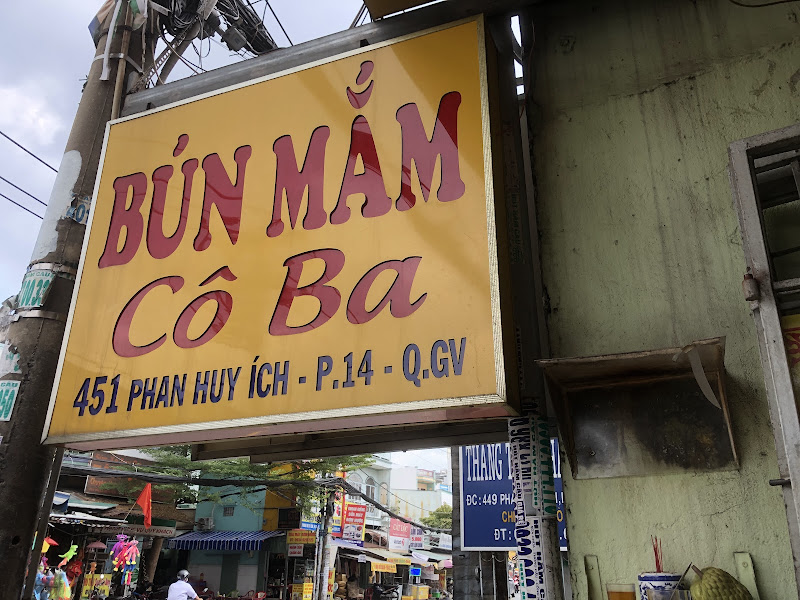
* **Địa chỉ:** 451 Phan Huy Ích, Phường 14, Quận Gò Vấp, TP.HCM
* **Hotline:** 0939 370 972
* **Món chính / Must-try:** Bún mắm thập cẩm tô đặc biệt, Bún mắm đầu cá, Topping tôm tươi, mực dày, heo quay giòn rụm & chả cá nhồi ớt, Rổ rau sống miền Tây (kèo nèo, bông súng, rau đắng)
* **Giá cả:** 55.000 - 90.000 VNĐ
* **Đánh giá & Điểm nổi bật:** Quán bún mắm nức tiếng nhất nhì trục đường Phan Huy Ích với lượng khách đông đúc mỗi ngày. Nước lèo nấu từ cốt mắm cá linh, cá sặc dậy mùi thơm đậm đà đặc trưng mà không hề bị gắt hay tanh. Topping ú ụ đẫm miệng với tôm mực tươi ngọt, chả cá chiên dai thơm, heo quay giòn rụm ăn cùng dĩa rau đồng tươi mát chấm nước mắm me chua ngọt chuẩn bài.
* **Nguồn review & Link bài viết:** [Foody & Đánh giá cộng đồng](https://www.foody.vn/ho-chi-minh/bun-mam-co-ba-phan-huy-ich)
* **Tags:** `#Gò Vấp`, `#Phan Huy Ích`, `#Bún mắm`, `#Đặc sản miền Tây`, `#Ăn trưa`, `#Ăn tối`, `#Quán mới`

---

## 35. Gà Nướng Anh Tư (Lê Quang Định - Bình Thạnh)
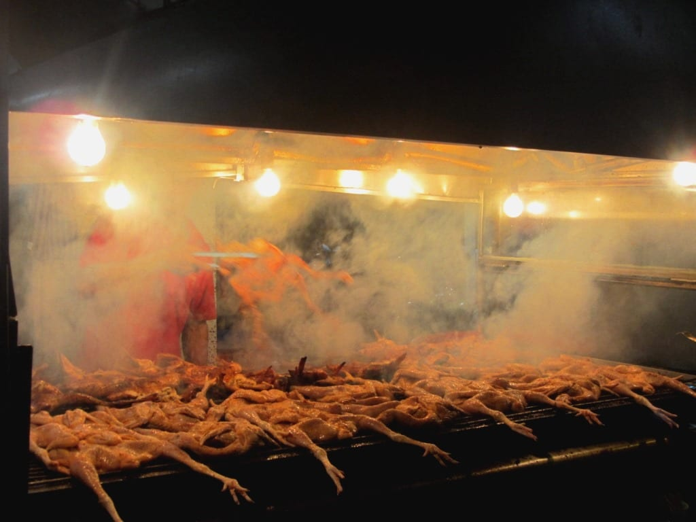
* **Địa chỉ:** 449 Lê Quang Định, Phường 11, Quận Bình Thạnh, TP.HCM
* **Hotline:** 0909 169 822
* **Món chính / Must-try:** Gà nướng than hoa da giòn rụm (nguyên con / nửa con), Nước sốt chấm đậu phộng béo bùi cay nhẹ độc quyền, Xôi chiên giòn, Chân & cánh gà nướng muối ớt
* **Giá cả:** 30.000 - 180.000 VNĐ
* **Đánh giá & Điểm nổi bật:** Hàng gà nướng than hoa nức tiếng lâu năm trên trục đường Lê Quang Định (Bình Thạnh), lúc nào cũng nghi ngút khói thơm lừng cả khu phố. Gà được tẩm ướp đậm đà, nướng than đỏ rực giúp lớp da vàng ươm giòn rụm mà thớ thịt bên trong vẫn mọng nước, dai ngọt tự nhiên. Điểm tạo nên thương hiệu của quán chính là chén nước sốt chấm đậu phộng sánh béo ngậy pha vị cay the, ăn kèm dưa leo, rau răm và ổ bánh mì hoặc xôi chiên cực kỳ bắt vị.
* **Nguồn review & Link bài viết:** [Foody & Vietnam Coracle Review](https://www.foody.vn/ho-chi-minh/anh-tu-ga-nuong)
* **Tags:** `#Bình Thạnh`, `#Lê Quang Định`, `#Gà nướng`, `#Gà nướng than`, `#Món nướng`, `#Ăn tối`, `#Quán mới`

---

## 36. Bánh Cuốn Trứng Vạn Kiếp (Vạn Kiếp - Bình Thạnh)
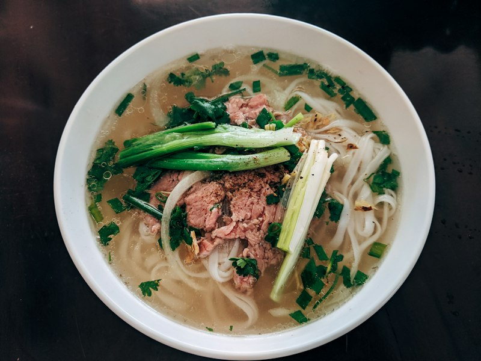
* **Địa chỉ:** 55/19 Vạn Kiếp, Phường 3, Quận Bình Thạnh, TP.HCM
* **Hotline:** 028 3510 4723
* **Món chính / Must-try:** Bánh cuốn trứng lòng đào béo ngậy, Bánh cuốn truyền thống thịt bằm nấm mèo xá bấu, Bánh cuốn thập cẩm chà bông & thịt gà xắt hạt lựu, Chả lụa, chả quế, hành phi tự phi giòn rụm
* **Giá cả:** 17.000 - 35.000 VNĐ
* **Đánh giá & Điểm nổi bật:** Hàng bánh cuốn núp hẻm nức tiếng lâu năm trên con đường ẩm thực Vạn Kiếp, lúc nào cũng tấp nập khách ăn sáng. Điểm đắt giá nhất là lớp vỏ bánh tráng mỏng mềm mướt bọc trọn lòng đỏ trứng gà béo ngậy tan chảy, nhân thịt bằm hòa quyện cùng thịt gà hạt lựu giòn ngọt lạ miệng. Đĩa bánh dọn ra nóng hổi ngập tràn hành phi thơm giòn, ăn kèm chả lụa dày miếng và nước mắm chua ngọt ấm bụng chuẩn vị sành ăn Sài Gòn.
* **Nguồn review & Link bài viết:** [Toplist & Đánh giá ẩm thực Vạn Kiếp](https://toplist.vn/top-list/quan-banh-cuon-ngon-nhat-quan-binh-thanh-tp-hcm-55915.htm)
* **Tags:** `#Bình Thạnh`, `#Vạn Kiếp`, `#Bánh cuốn trứng`, `#Bánh cuốn nóng`, `#Món sáng`, `#Núp hẻm`, `#Quán mới`

---

## 37. Há Cảo 45 (Nguyễn Văn Lạc - Bình Thạnh)
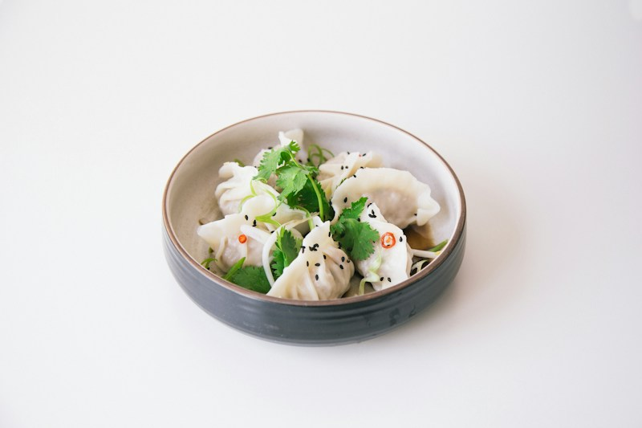
* **Địa chỉ:** 45 Nguyễn Văn Lạc, Phường 19, Quận Bình Thạnh, TP.HCM
* **Hotline:** 0906 385 018
* **Món chính / Must-try:** Há cảo tôm thịt hấp nóng hổi (vỏ mỏng dai mềm, nhân ngọt đậm), Xíu mại tôm, xíu mại trứng cút, Bánh xếp hẹ, há cảo chiên giòn rụm, Nước tương pha dấm chua ngọt ăn kèm hành phi giòn và rau răm
* **Giá cả:** 30.000 - 50.000 VNĐ (5.000 VNĐ/viên)
* **Đánh giá & Điểm nổi bật:** Quán há cảo lề đường nức tiếng nhiều năm khu Nguyễn Văn Lạc (gần cầu Thị Nghè), lúc nào cũng tấp nập khách ăn tại chỗ lẫn mua mang về. Các loại há cảo, xíu mại, bánh xếp được hấp liên tục trong các xửng tre bốc khói nghi ngút. Viên há cảo ú nu, vỏ mỏng dẻo không bở, nhân thịt tôm ngọt thơm đậm đà, phủ ngập hành phi thơm lừng cùng chén nước tương dấm chua ngọt chuẩn vị xế chiều Sài Gòn.
* **Nguồn review & Link bài viết:** [Google Maps Review & Đánh giá cộng đồng](https://www.google.com/maps/place?q=place_id:ChIJpfDAJbIodTERpuISnZOEYRM)
* **Tags:** `#Bình Thạnh`, `#Nguyễn Văn Lạc`, `#Thị Nghè`, `#Há cảo`, `#Xíu mại`, `#Ăn vặt`, `#Quán mới`

---

## 38. Cơm Tấm Hẻm 33 (Nguyễn Đình Chính - Phú Nhuận)
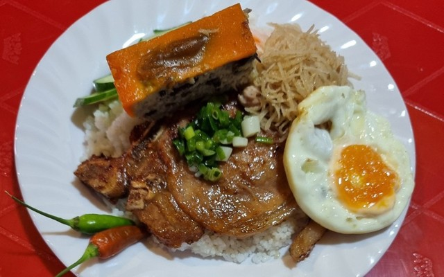
* **Địa chỉ:** 33/16 Nguyễn Đình Chính, Phường 15, Quận Phú Nhuận, TP.HCM
* **Hotline:** 0933 616 230
* **Món chính / Must-try:** Cơm tấm nạc giòn (thịt nạc nọng nướng than sần sật béo ngậy), Sườn nướng than hoa đậm đà gia truyền, Chả cua hấp béo thơm, Bì sợi giòn dai, Nước mắm kẹo sóng sánh kèm tóp mỡ giòn rụm
* **Giá cả:** 35.000 - 80.000 VNĐ
* **Đánh giá & Điểm nổi bật:** Quán cơm tấm núp hẻm nức tiếng Phú Nhuận được chấm 4.4/5 sao trên Google Maps với hàng trăm lượt đánh giá. Quán tạo nên cơn sốt ẩm thực nhờ món "nạc giòn" (thịt nọng heo) nướng than hồng lạ miệng vừa béo vừa giòn sần sật hiếm nơi nào có, hòa quyện cùng hạt cơm tấm tơi dẻo, sườn ướp thấm vị và chén nước mắm kẹo sóng sánh chuẩn gu Sài Gòn.
* **Nguồn review & Link bài viết:** [Google Maps Review & Đánh giá ẩm thực Sài Gòn](https://www.google.com/maps/place?q=place_id:ChIJu6dThdYodTERPWbff_EopDI)
* **Tags:** `#Phú Nhuận`, `#Nguyễn Đình Chính`, `#Cơm tấm`, `#Nạc giòn`, `#Nạc nọng`, `#Núp hẻm`, `#Quán mới`

---

## 39. Cơm Tấm Cây Thị (Lê Đức Thọ - Gò Vấp)

* **Địa chỉ:** 456 Lê Đức Thọ, Phường 17, Quận Gò Vấp, TP.HCM
* **Hotline:** 0937 468 780
* **Món chính / Must-try:** Sườn nướng than hoa đậm đà, Sườn cây nướng mọng nước, Bì chả, trứng ốp la lòng đào, Mỡ hành tóp mỡ giòn rụm xin thêm thoải mái, Nước mắm kẹo dẻo cay nhẹ
* **Giá cả:** 25.000 - 50.000 VNĐ
* **Đánh giá & Điểm nổi bật:** Hàng cơm tấm bình dân nức tiếng trên trục đường Lê Đức Thọ (Gò Vấp), luôn tấp nập khách từ xế chiều đến nửa đêm. Sườn nướng than hoa vàng ươm, thơm lừng không bị khô, hạt cơm tấm tơi xốp, chén tóp mỡ mỡ hành béo ngậy giòn rụm được cho rất hào phóng kèm nước mắm kẹo đậm đà chuẩn gu Sài Gòn.
* **Nguồn review & Link bài viết:** [Google Maps Review & Đánh giá ẩm thực Gò Vấp](https://www.google.com/maps/place?q=place_id:ChIJ5fI32R8pdTER3R0TCCwI5gg)
* **Tags:** `#Gò Vấp`, `#Lê Đức Thọ`, `#Cơm tấm`, `#Sườn nướng`, `#Ăn tối`, `#Ăn đêm`, `#Quán mới`

---

## 40. Bún Thịt Nướng Kiều Bảo (Quang Trung - Gò Vấp)
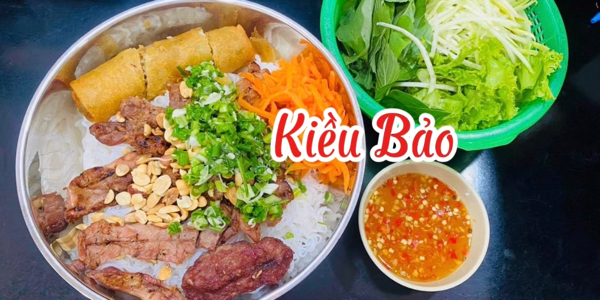
* **Địa chỉ:** 850 Quang Trung, Phường 8, Quận Gò Vấp, TP.HCM
* **Hotline:** 0939 604 937
* **Món chính / Must-try:** Bún thịt nướng đầy đủ (thịt nướng, nem nướng, chả giò), Chả giò chiên nóng giòn rụm, Nem nướng thơm đậm vị, Refill rau sống và bún tươi miễn phí
* **Giá cả:** 25.000 - 40.000 VNĐ
* **Đánh giá & Điểm nổi bật:** Quán bún thịt nướng nổi tiếng Gò Vấp với 1.170+ lượt đánh giá trên Google Maps (4.1/5 sao) và cộng đồng Lemon8/Foody. Điểm hút khách lớn nhất là chính sách refill rau sống và bún tươi hoàn toàn miễn phí. Thịt nướng ướp đậm đà cháy xém nhẹ, chả giò chiên nóng giòn rụm, nước mắm chua ngọt thơm mùi tỏi vừa miệng; mở cửa từ 11h00 đến 21h00.
* **Nguồn review & Link bài viết:** [Google Maps Review, Foody & Lemon8](https://www.google.com/maps/place?q=place_id:ChIJN_5VAZ8pdTERPj35-iSPUPk)
* **Tags:** `#Gò Vấp`, `#Quang Trung`, `#Bún thịt nướng`, `#Chả giò`, `#Refill miễn phí`, `#Bình dân`, `#Quán mới`

---

## 41. Tiệm Lẩu Bò Trăm Rưỡi (Phan Văn Trị - Gò Vấp)
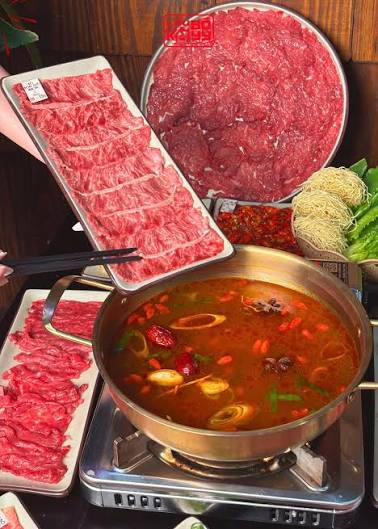
* **Địa chỉ:** 701 Phan Văn Trị, Quận Gò Vấp, TP.HCM (còn có chi nhánh 685 Quang Trung, 107 Lê Đức Thọ & 342 Phan Huy Ích)
* **Hotline:** 0855 660 779
* **Món chính / Must-try:** Set lẩu bò Triều Châu 150k, Gù bò & Gầu bò thái tay, Tàu hũ ky cuộn tôm, Bò gân viên Tứ Xuyên, Quầy nước chấm tự chọn miễn phí
* **Giá cả:** 150.000 - 200.000 VNĐ
* **Đánh giá & Điểm nổi bật:** Quán lẩu bò Triều Châu gây sốt MXH và báo chí năm 2026 với mức giá chỉ từ 150k/set đầy đặn. Bò nhập tươi mỗi ngày và thái tay tại quầy để thực khách quan sát trực tiếp; nổi bật nhất là gù bò, gầu bò giòn sần sật, tàu hũ ky cuộn tôm đậm vị và quầy nước chấm đa dạng. Mở cửa 16:00 - 00:30, buổi tối cực kỳ đông khách thường phải chờ bàn.
* **Nguồn review & Link bài viết:** [Kenh14, CafeF & TikTok Food Review](https://kenh14.vn/quan-lau-bo-tram-ruoi-dong-toi-muc-khach-ghe-4-lan-chi-2-lan-duoc-ngoi-215260814132519162.chn)
* **Tags:** `#Gò Vấp`, `#Phan Văn Trị`, `#Lẩu bò`, `#Lẩu bò Triều Châu`, `#Ăn tối`, `#Ăn đêm`, `#Quán mới`

---

## 42. Quán Thái Khapi (Ung Văn Khiêm - Bình Thạnh)
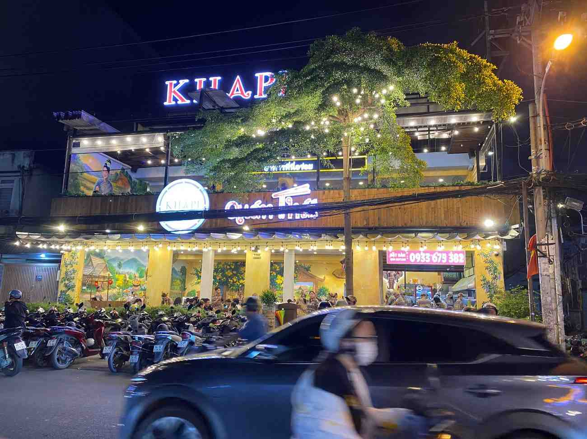
* **Địa chỉ:** 100 Ung Văn Khiêm, Phường 25, Quận Bình Thạnh, TP.HCM
* **Hotline:** 0933 675 382
* **Món chính / Must-try:** Gỏi đu đủ ba khía (79k), Tháp sườn cay, Pad Thái xào wok, Cơm chiên mắm ruốc Thái
* **Giá cả:** 100.000 - 200.000 VNĐ
* **Đánh giá & Điểm nổi bật:** Quán Thái nổi tiếng trên TikTok (@quanthai.khapi 50.9K followers) với hương vị Thái Lan nguyên bản đậm đà, không bị Việt hóa nhạt vị. Menu hơn 36 món từ gỏi đu đủ ba khía chua cay bùng nổ (79k) đến tháp sườn cay và cơm chiên mắm ruốc; không gian 2 tầng có lầu chill cho nhóm bạn và bãi đậu ô tô. Mở cửa 11:00 - 23:00 hàng ngày.
* **Nguồn review & Link bài viết:** [TikTok & Vietinsiders Review](https://vietinsiders.com/places/quan-thai-khapi-ung-van-khiem-binh-thanh)
* **Tags:** `#Bình Thạnh`, `#Ung Văn Khiêm`, `#Món Thái`, `#Tháp sườn cay`, `#Gỏi ba khía`, `#Tụ tập bạn bè`, `#Quán mới`

---

## 43. KHÈN - Nướng Sapa (Vincom Quang Trung - Gò Vấp)
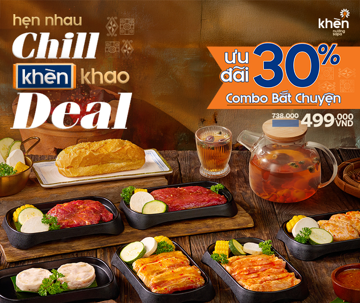
* **Địa chỉ:** Tầng 2 TTTM Vincom Plaza Quang Trung, 190 Quang Trung, Phường 10, Quận Gò Vấp, TP.HCM
* **Hotline:** 1900 636 886
* **Món chính / Must-try:** Bò Bản Tươi Nướng Khói Sapa & Xốt Mường Khương, Ba Chỉ Heo & Má Heo Xốt Bản Mường, Combo Bắt Chuyện 9 món (499k), Chạo Tôm Tươi & Cánh Gà Xốt Mường Khương, Bánh Mì Nướng Mật Ong Rừng
* **Giá cả:** 200.000 - 300.000 VNĐ
* **Đánh giá & Điểm nổi bật:** Nhà hàng nướng than hoa phong cách Tây Bắc Sapa trong không gian máy lạnh tại Vincom Quang Trung (Gò Vấp), đạt 5.0/5 sao từ hơn 1.000 đánh giá trên Google Maps và viral trên TikTok/Facebook. Thịt ướp gia vị bản địa đậm đà ăn kèm xốt Mường Khương cay tê đặc trưng, có các combo mâm nướng 9 món tiết kiệm cho nhóm bạn. Mở cửa 10:00 - 22:00 hàng ngày.
* **Nguồn review & Link bài viết:** [TikTok, Facebook & Google Maps Review](https://khen.vn/khuyen-mai/giam-30-combo-bat-chuyen/)
* **Tags:** `#Gò Vấp`, `#Quang Trung`, `#Nướng Sapa`, `#Nướng than hoa`, `#Tây Bắc`, `#Tụ tập bạn bè`, `#Quán mới`

---

## 44. Bún Chả Hà Nội Thành Phát (Đường Số 9 - Gò Vấp)
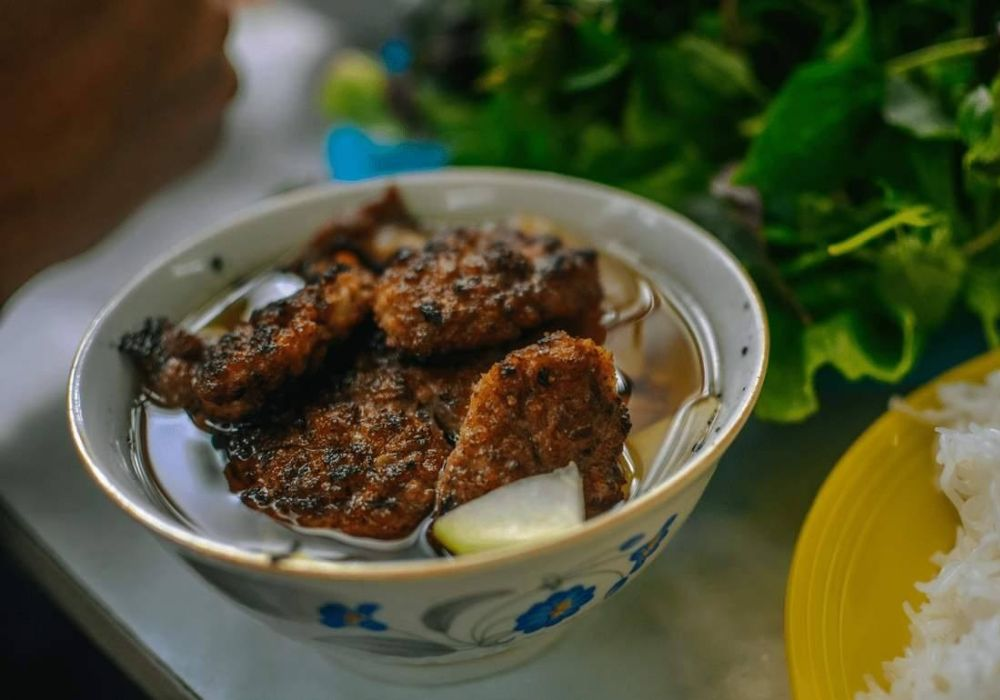
* **Địa chỉ:** 45 Đường Số 9, Phường 16, Quận Gò Vấp, TP.HCM
* **Món chính / Must-try:** Bún chả Hà Nội đầy đủ (chả miếng & chả băm), Chả thịt nướng than hoa, Nước mắm chua ngọt kèm đu đủ xanh giòn rụm
* **Giá cả:** 50.000 - 100.000 VNĐ
* **Đánh giá & Điểm nổi bật:** Quán bún chả chuẩn vị Hà Nội nổi tiếng tại khu vực Đường Số 9 (Gò Vấp), được đánh giá 4.7/5 sao trên Google Maps. Phần bún đầy đặn với chả thịt nướng than thơm phức, cân bằng tỉ lệ nạc mỡ mềm mọng không bị khô, ăn kèm rau sống tươi và nước mắm chua ngọt cay nhẹ cùng đu đủ xanh bào giòn. Mở cửa từ 06:00 - 20:00.
* **Nguồn review & Link bài viết:** [Green SM & Google Maps Review](https://www.greensm.com/vn-vi/news/bun-cha-ha-noi-o-tphcm)
* **Tags:** `#Gò Vấp`, `#Đường Số 9`, `#Bún chả Hà Nội`, `#Ăn sáng`, `#Ăn trưa`, `#Quán mới`

---

## 45. CLOUD POT - Lẩu Hấp Thủy Nhiệt (Phan Xích Long - Phú Nhuận)
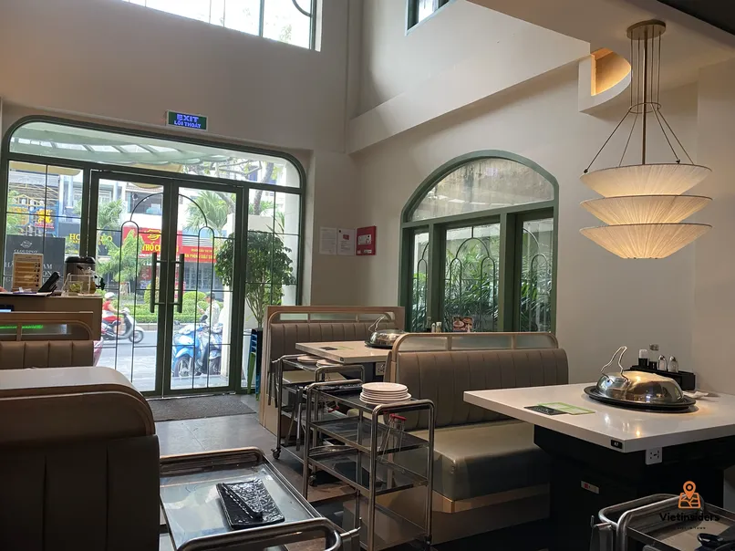
* **Địa chỉ:** 147 Phan Xích Long, Phường 2, Quận Phú Nhuận, TP.HCM
* **Hotline:** 028 7304 0637
* **Món chính / Must-try:** Lẩu hấp thủy nhiệt Tầng Mây Của Biển (hải sản tươi sống), Lẩu hấp Tầng Mây Trang Trại (bò, bê, gà), Cháo đáy nồi nấu từ nước cốt hấp ngọt thanh, Buffet nước chấm, nước uống & tráng miệng
* **Giá cả:** 200.000 - 300.000 VNĐ
* **Đánh giá & Điểm nổi bật:** Quán lẩu hấp thủy nhiệt đang hot trên TikTok (@cloudpotphanxichlong) & khu Phan Xích Long (Phú Nhuận), set khoảng 199K/người ăn no kèm buffet nước chấm và tráng miệng. Nguyên liệu tươi hấp hơi nước giữ trọn vị ngọt tự nhiên, không dầu mỡ, đặc biệt phần nước cốt nhỏ xuống dùng nấu cháo đáy nồi cực kỳ thanh ngọt. Không gian thoáng, có phòng riêng, mở cửa 10:00 - 22:00 hàng ngày.
* **Nguồn review & Link bài viết:** [TikTok & Vietinsiders Review](https://vietinsiders.com/places/cloud-pot-phan-xich-long/)
* **Tags:** `#Phú Nhuận`, `#Phan Xích Long`, `#Lẩu hấp thủy nhiệt`, `#Healthy`, `#Hải sản`, `#Tụ tập bạn bè`, `#Quán mới`

---

## 46. UTAGE Yokocho - Nhà Hàng Nhật Bản (Nguyễn Gia Trí - Bình Thạnh)
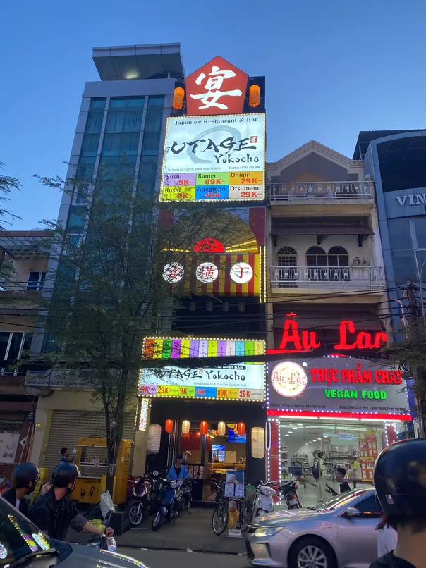
* **Địa chỉ:** 163 Nguyễn Gia Trí, Phường 25, Quận Bình Thạnh, TP.HCM
* **Hotline:** 076 416 3300
* **Món chính / Must-try:** Yakitori (thịt nướng xiên than hoa), Sashimi & Sushi cá hồi bơ tươi, Gà rán Karaage giòn rụm, Tempura tôm & rau củ, Rượu Sake, Shochu & Cocktail Nhật
* **Giá cả:** 200.000 - 300.000 VNĐ
* **Đánh giá & Điểm nổi bật:** Quán izakaya chuẩn phong cách phố ẩm thực Nhật Bản trên đường Nguyễn Gia Trí (Bình Thạnh), đạt 4.9/5 sao từ 764 đánh giá trên Google Maps. Không gian ấm cúng tái hiện con phố Yokocho với quầy bar tương tác cùng đầu bếp, bàn nhóm và chỗ ngồi ngoài trời. Món ăn chuẩn vị từ yakitori nướng than, sashimi tươi đến karaage giòn tan, mở cửa muộn 11:00 - 00:00 hàng ngày.
* **Nguồn review & Link bài viết:** [Facebook, Vietinsiders & Google Maps Review](https://vietinsiders.com/places/utage-yokocho-binh-thanh/)
* **Tags:** `#Bình Thạnh`, `#Nguyễn Gia Trí`, `#Izakaya`, `#Món Nhật`, `#Yakitori`, `#Sashimi`, `#Ăn đêm`, `#Quán mới`
