# Bản Đồ Ẩm Thực (Food Map)

Kho lưu trữ các quán ăn, món ngon, review thực tế thu thập hàng ngày từ Threads, MXH và cộng đồng ẩm thực.

* **Dữ liệu chuẩn JSON (Web/API ready):** [`food_places.json`](./food_places.json)
* **Hình ảnh thực tế:** [`images/`](./images/)

---

## 1. Đặc Sản Cô 7 - Phan Thiết (Gò Vấp)
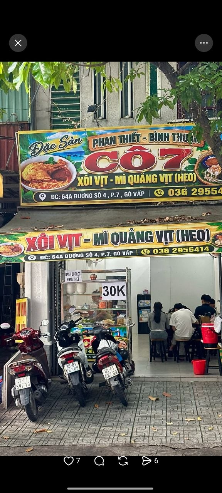
* **Địa chỉ:** 64A Đường số 4, Phường 7, Quận Gò Vấp, TP.HCM
* **Hotline:** 0362955414
* **Món chính / Must-try:** Xôi Vịt, Mì Quảng Vịt, Mì Quảng Heo, Bánh bột lọc Phan Thiết
* **Giá cả:** 30.000 VNĐ
* **Đánh giá & Điểm nổi bật:** Quán bình dân đặc sản Phan Thiết - Bình Thuận, xôi dẻo thịt vịt mềm, mì quảng vịt/heo chuẩn vị, bánh bột lọc dai ngon niêm yết đồng giá 30k.
* **Nguồn review & Link bài viết:** [Threads / Ảnh gửi](https://www.threads.net)
* **Tags:** `#Gò Vấp`, `#Ăn sáng`, `#Ăn trưa`, `#Xôi vịt`, `#Mì Quảng`, `#Bình dân`, `#Phan Thiết`

---

## 2. Bún Chả Hà Nội & Bánh Cuốn Thịt Nướng (tuiminhbanbuncha.29) (Quận 12)
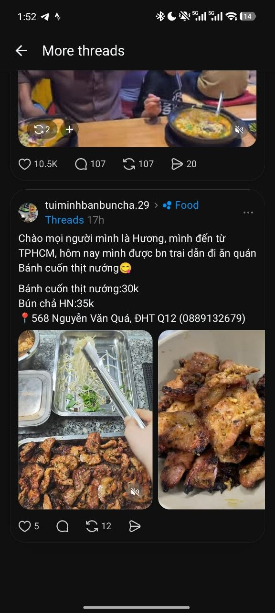
* **Địa chỉ:** 568 Nguyễn Văn Quá, P. Đông Hưng Thuận, Quận 12, TP.HCM (giáp Gò Vấp)
* **Hotline:** 0889132679
* **Món chính / Must-try:** Bún chả Hà Nội, Bánh cuốn thịt nướng
* **Giá cả:** 30.000 - 35.000 VNĐ
* **Đánh giá & Điểm nổi bật:** Bánh cuốn thịt nướng thơm nức 30k, bún chả Hà Nội nướng than chả viên thơm mềm nước mắm pha chua ngọt thanh 35k.
* **Nguồn review & Link bài viết:** [Threads (@tuiminhbanbuncha.29)](https://www.threads.net/@tuiminhbanbuncha.29)
* **Tags:** `#Quận 12`, `#Gần Gò Vấp`, `#Bún chả`, `#Bánh cuốn`, `#Bình dân`

---

## 3. Cơm Tấm Đêm 6 Tèo (Gò Vấp)
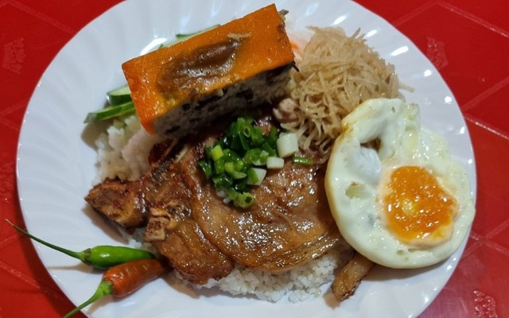
* **Địa chỉ:** 400 Phan Văn Trị, Phường 7, Quận Gò Vấp, TP.HCM
* **Món chính / Must-try:** Cơm tấm sườn nướng, Sườn bì chả trứng ốp la, Lạp xưởng
* **Giá cả:** 35.000 - 55.000 VNĐ
* **Đánh giá & Điểm nổi bật:** Quán cơm tấm đêm siêu đông khách, sườn ướp đậm đà nướng than thơm lừng không bị khô, nước mắm kẹo bắt miệng, phục vụ nhanh.
* **Nguồn review & Link bài viết:** [Threads / MXH Food Review](https://www.lemon8-app.com/@saigon_angi27590/7682637121236107794)
* **Tags:** `#Gò Vấp`, `#Cơm tấm`, `#Ăn đêm`, `#Phan Văn Trị`

---

## 4. Ốc Lắc Cô Mai (Gò Vấp)
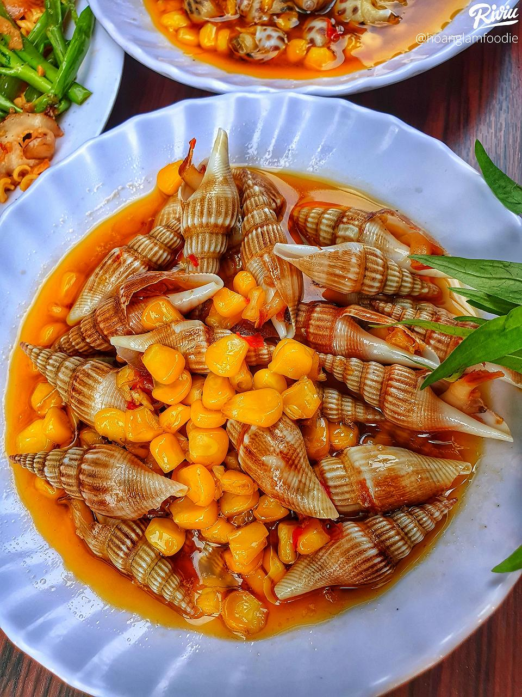
* **Địa chỉ:** Hẻm 36/14 Thoại Ngọc Hầu / Núp hẻm Quang Trung, Quận Gò Vấp, TP.HCM
* **Món chính / Must-try:** Ốc lắc sốt phô mai, Ốc hương sốt trứng muối, Càng ghẹ rang muối
* **Giá cả:** 40.000 - 90.000 VNĐ
* **Đánh giá & Điểm nổi bật:** Quán ốc núp hẻm có view sân thượng cực chill, hải sản tươi ngon đậm đà, nhân viên nhiệt tình, đông khách vào chiều tối.
* **Nguồn review & Link bài viết:** [Threads / TopTop](https://www.lemon8-app.com/@naominhcunglan_/7188094721783366146)
* **Tags:** `#Gò Vấp`, `#Ốc`, `#Sân thượng`, `#Tụ tập bạn bè`

---

## 5. Lẩu Ếch Sáu Hiếu (Gò Vấp)
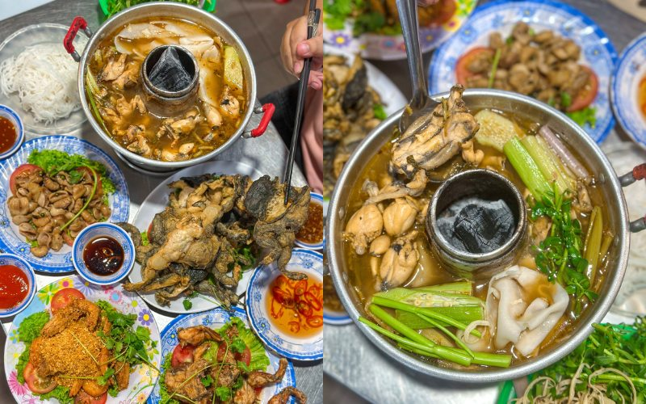
* **Địa chỉ:** 429/9 Quang Trung, Phường 10, Quận Gò Vấp, TP.HCM
* **Món chính / Must-try:** Lẩu ếch măng cay, Da ếch chiên giòn, Ếch xào lăn
* **Giá cả:** 100.000 - 200.000 VNĐ
* **Đánh giá & Điểm nổi bật:** Thương hiệu lẩu ếch trứ danh Gò Vấp, da ếch chiên giòn rụm béo thơm, lẩu măng cay chua ngọt vừa miệng cực kỳ đông khách.
* **Nguồn review & Link bài viết:** [Cộng đồng ẩm thực Gò Vấp](https://toplist.vn/top-list/quan-lau-ech-ngon-re-duoc-yeu-thich-nhat-tai-tp-hcm-46512.htm)
* **Tags:** `#Gò Vấp`, `#Lẩu ếch`, `#Quang Trung`, `#Gia đình`, `#Hội nhóm`

---

## 6. Chân Gà Sốt Thái Cô Minh (Gò Vấp)
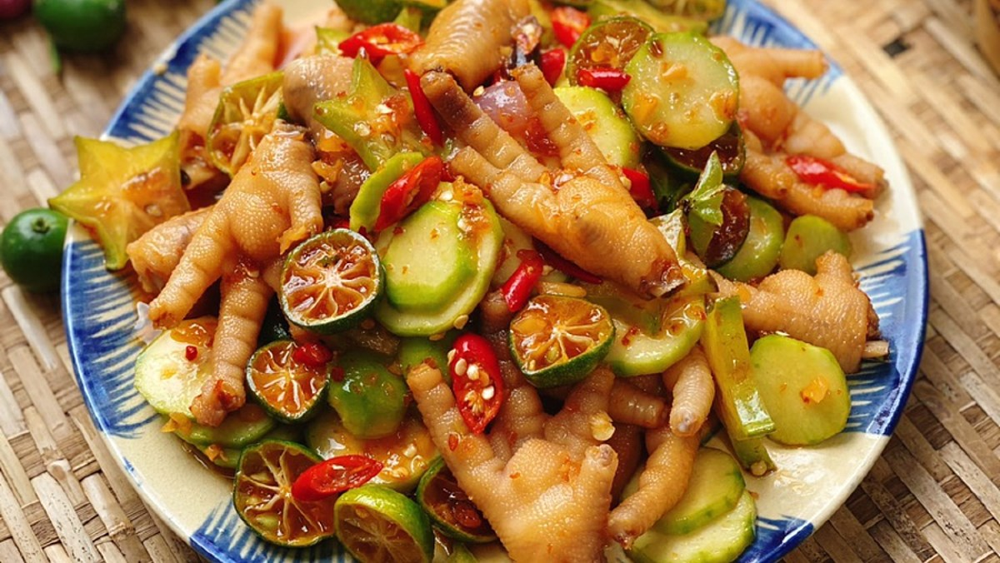
* **Địa chỉ:** 305 Nguyễn Văn Khối (Cây Trâm cũ), Phường 9, Quận Gò Vấp, TP.HCM
* **Món chính / Must-try:** Chân gà rút xương sốt Thái, Tai heo sốt Thái
* **Giá cả:** 60.000 - 100.000 VNĐ
* **Đánh giá & Điểm nổi bật:** Xe chân gà nổi tiếng cõi mạng; sốt Thái đặc sệt thơm cay tê, chân gà rút xương giòn sần sật thấm đều gia vị (bán từ 15h đến hết).
* **Nguồn review & Link bài viết:** [Threads / TikTok viral](https://www.lemon8-app.com/theotheoriviu/7239231897677595137)
* **Tags:** `#Gò Vấp`, `#Ăn vặt`, `#Chân gà sốt Thái`, `#Nguyễn Văn Khối`

---

## 7. Bún Riêu 336 Nguyễn Văn Lượng (Gò Vấp)
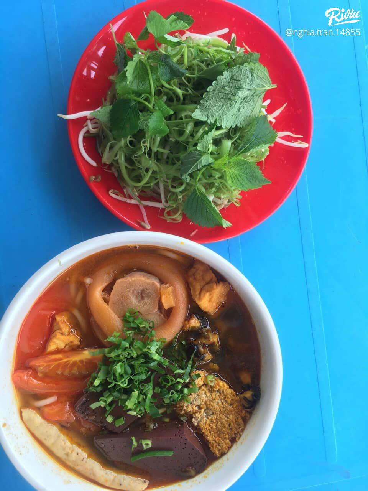
* **Địa chỉ:** 336 Nguyễn Văn Lượng, Phường 16, Quận Gò Vấp, TP.HCM (đối diện Lotte Mart)
* **Món chính / Must-try:** Bún riêu cua ốc thập cẩm, Chả lụa, Chả tiêu
* **Giá cả:** 20.000 - 35.000 VNĐ
* **Đánh giá & Điểm nổi bật:** Tô thập cẩm 35k đầy ụ thịt thà, riêu cua thơm lừng, ốc giòn, nước lèo ngọt thanh đậm đà, bán từ 6h sáng đến 14h trưa.
* **Nguồn review & Link bài viết:** [Review ẩm thực](https://www.momo.vn/page/9814046)
* **Tags:** `#Gò Vấp`, `#Bún riêu`, `#Ăn sáng`, `#Giá rẻ`

---

## 8. Bún Cá Rô Đồng Hoàng Cúc (Gò Vấp)

* **Địa chỉ:** 236 Nguyễn Oanh, Phường 17, Quận Gò Vấp, TP.HCM
* **Món chính / Must-try:** Bún cá rô đồng chiên giòn, Bún cá rô hấp, Măng cay
* **Giá cả:** 35.000 - 55.000 VNĐ
* **Đánh giá & Điểm nổi bật:** Thịt cá rô đồng lọc xương chiên vàng giòn thơm nức, nước dùng cá ngọt thanh tự nhiên ăn kèm rau cần, cải mầm và măng chua ngâm giòn.
* **Nguồn review & Link bài viết:** [Foody / Người dân địa phương](https://vntopfood.com/bun-ca-go-vap/)
* **Tags:** `#Gò Vấp`, `#Bún cá rô`, `#Nguyễn Oanh`, `#Thanh đạm`

---

## 9. Lẩu Dê SOS Làng Hoa (20 năm) (Gò Vấp)
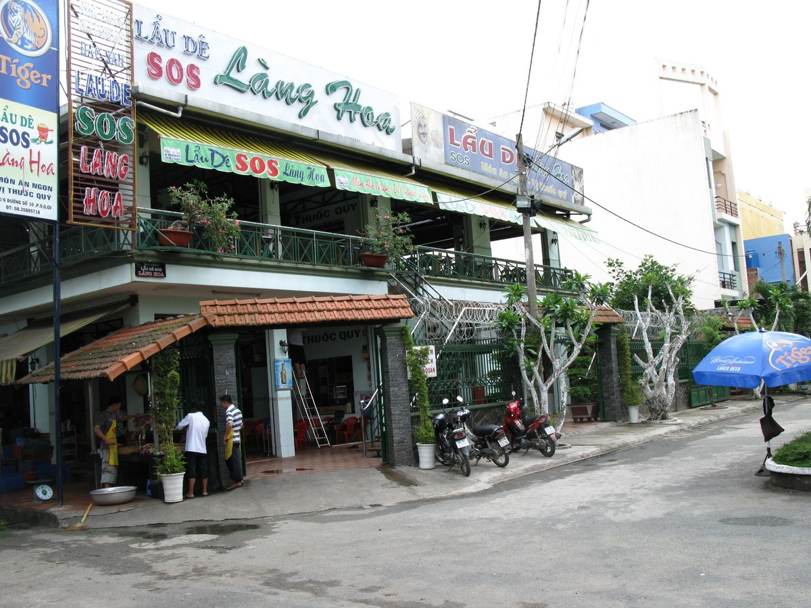
* **Địa chỉ:** 108/6 Nguyễn Văn Khối, Phường 9, Quận Gò Vấp, TP.HCM
* **Món chính / Must-try:** Lẩu dê nhúng, Dê nướng mọi, Vú dê nướng, Dê hấp tía tô
* **Giá cả:** 150.000 - 300.000 VNĐ
* **Đánh giá & Điểm nổi bật:** Hơn 20 năm tuổi trứ danh làng hoa Gò Vấp, thịt dê tươi không hôi, chao chấm béo cay mặn mà, nước lẩu thảo mộc thơm bổ dưỡng.
* **Nguồn review & Link bài viết:** [Review ẩm thực Sài Gòn](https://www.bachhoaxanh.com/kinh-nghiem-hay/5-quan-lau-sieu-ngon-ban-lau-nam-ma-dan-go-vap-thuong-ghe-1314109)
* **Tags:** `#Gò Vấp`, `#Lẩu dê`, `#Lâu đời`, `#Hội họp`

---

## 10. Phá Lấu Bò Cây Trâm (Gò Vấp)
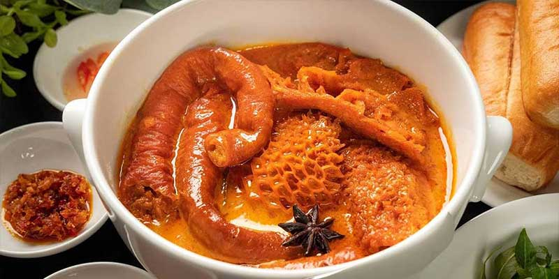
* **Địa chỉ:** 208 Cây Trâm (Nguyễn Văn Khối), Phường 8, Quận Gò Vấp, TP.HCM
* **Món chính / Must-try:** Phá lấu chén, Mì gói phá lấu, Bánh mì phá lấu
* **Giá cả:** 25.000 - 40.000 VNĐ
* **Đánh giá & Điểm nổi bật:** Lòng bò làm sạch kĩ không mùi, nước cốt dừa béo ngọt vừa vặn, nước mắm me chua cay chấm siêu dính, bánh mì luôn giòn rụm.
* **Nguồn review & Link bài viết:** [Food review](https://trangvangamthuc.com/pha-lau-bo-cay-tram/)
* **Tags:** `#Gò Vấp`, `#Phá lấu bò`, `#Ăn vặt xế chiều`

---

## 11. Ngõ Thái (Gò Vấp)
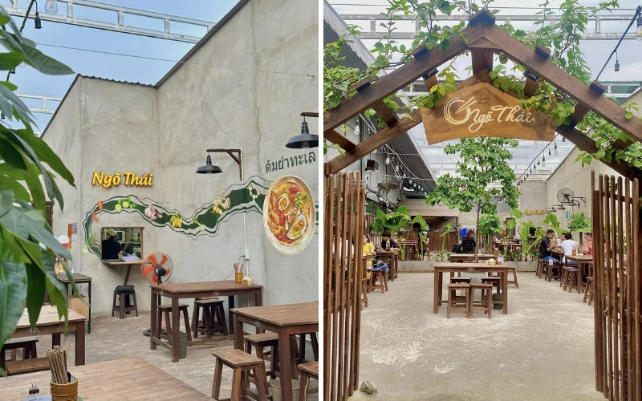
* **Địa chỉ:** 945/64B Lê Đức Thọ, Phường 16, Quận Gò Vấp, TP.HCM
* **Món chính / Must-try:** Sườn cây tắm ớt hiểm, Cà ri hải sản xanh, Gỏi xoài cá trê, Xôi xoài
* **Giá cả:** 50.000 - 120.000 VNĐ
* **Đánh giá & Điểm nổi bật:** Quán món Thái núp hẻm ấm cúng giá cực kỳ 'hạt dẻ' so với nhà hàng; món sườn cây ớt hiểm chuẩn vị cay nồng, nên đặt bàn trước sau 18h.
* **Nguồn review & Link bài viết:** [Threads / Food review](https://angiday.me/do-an-kieu-thai-ngo-thai)
* **Tags:** `#Gò Vấp`, `#Món Thái`, `#Sườn cây`, `#Núp hẻm`

---

## 12. Bò Bít Tết Củ Hành Tây (Gò Vấp) (Gò Vấp)
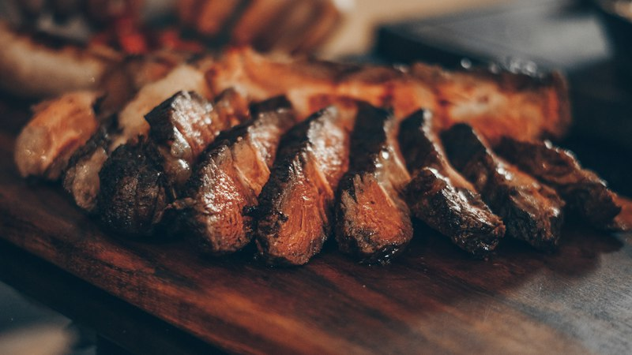
* **Địa chỉ:** 393 - 395 Lê Quang Định, P.5 & 189 Nguyễn Oanh, P.17, Gò Vấp, TP.HCM
* **Hotline:** 028 3515 0524
* **Món chính / Must-try:** Bít tết thập cẩm (bò, pate, trứng ốp la, xíu mại, phô mai), Bò sốt tiêu đen, Bánh mì nóng giòn, Salad dầu giấm
* **Giá cả:** 65.000 - 120.000 VNĐ
* **Đánh giá & Điểm nổi bật:** Quán bít tết lâu năm nức tiếng Gò Vấp, thịt bò ướp mềm đậm vị không bị dai, chảo gang nóng xèo xèo, không gian máy lạnh sạch sẽ, phục vụ rất nhanh.
* **Nguồn review & Link bài viết:** [Review ẩm thực Sài Gòn / Foody](https://www.foody.vn/ho-chi-minh/bo-cu-hanh-tay-le-quang-dinh)
* **Tags:** `#Gò Vấp`, `#Bò bít tết`, `#Củ Hành Tây`, `#Lê Quang Định`, `#Nguyễn Oanh`, `#Ăn tối`

---

## 13. Beefsteak TiTi (Phan Văn Trị) (Gò Vấp)
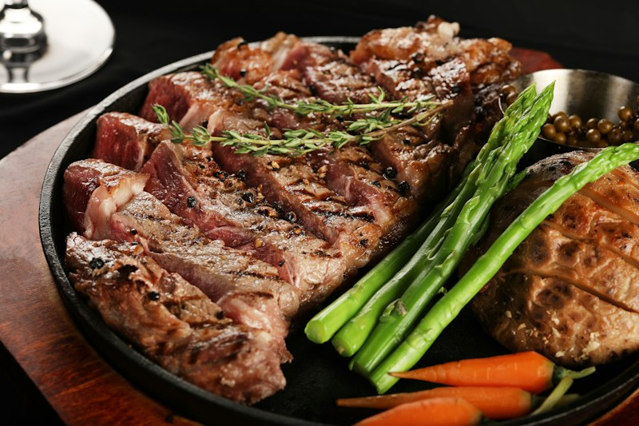
* **Địa chỉ:** 467 Phan Văn Trị, Phường 5, Quận Gò Vấp, TP.HCM (gần Emart)
* **Hotline:** 090 274 72 73
* **Món chính / Must-try:** Bò Mỹ sốt tiêu đen, Bò sốt phô mai cay, Khoai tây nghiền, Salad cá ngừ
* **Giá cả:** 90.000 - 180.000 VNĐ
* **Đánh giá & Điểm nổi bật:** Không gian ấm cúng, sang trọng vừa phải rất hợp hẹn hò hoặc ăn gia đình; thịt bò mềm mọng nước có thể chọn độ chín (Medium-rare/Medium), sốt tiêu và phô mai béo thơm đặc trưng.
* **Nguồn review & Link bài viết:** [Foody / Riviu Beefsteak](https://www.foody.vn/ho-chi-minh/beefsteak-titi-phan-van-tri)
* **Tags:** `#Gò Vấp`, `#Beefsteak`, `#TiTi`, `#Phan Văn Trị`, `#Hẹn hò`, `#Gia đình`

---

## 14. Bò Bít Tết Hỏa Xa (Gò Vấp)
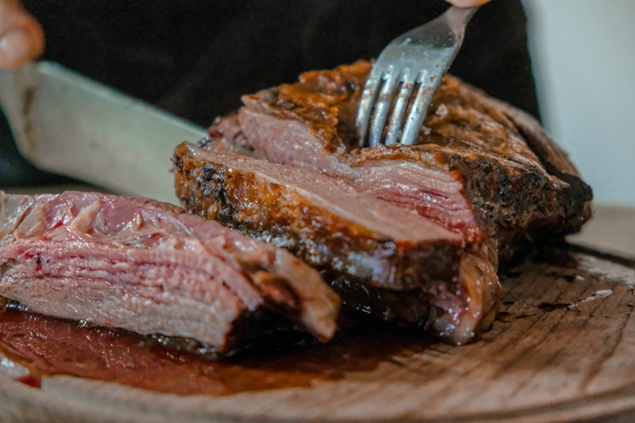
* **Địa chỉ:** 168 Phan Văn Trị, Phường 10, Quận Gò Vấp, TP.HCM
* **Món chính / Must-try:** Bít tết chảo gang truyền thống, Bò né thập cẩm, Bắp bò lúc lắc
* **Giá cả:** 45.000 - 85.000 VNĐ
* **Đánh giá & Điểm nổi bật:** Bít tết phong cách truyền thống bình dân mở lâu năm; pate béo bùi, nước sốt sệt chấm bánh mì cực cuốn, giá bình dân.
* **Nguồn review & Link bài viết:** [Cộng đồng ẩm thực Gò Vấp](https://www.foody.vn/ho-chi-minh/bit-tet-hoa-xa)
* **Tags:** `#Gò Vấp`, `#Bò bít tết`, `#Hỏa Xa`, `#Phan Văn Trị`, `#Bình dân`

---

## 15. Bò Bít Tết & Bò Né 3 Ngon (Gò Vấp)
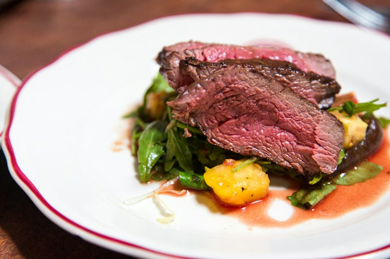
* **Địa chỉ:** 484 Lê Văn Thọ, Phường 16, Quận Gò Vấp, TP.HCM
* **Món chính / Must-try:** Chảo bò né thập cẩm đặc biệt, Bò bít tết phô mai, Xúc xích trứng ốp la
* **Giá cả:** 35.000 - 65.000 VNĐ
* **Đánh giá & Điểm nổi bật:** Chuỗi bò né bình dân giá sinh viên quen thuộc; chảo gang sôi bùng khói thơm phức, phục vụ nhanh, ăn sáng hay ăn tối đều tiện.
* **Nguồn review & Link bài viết:** [Địa điểm ăn uống Gò Vấp](https://www.foody.vn/ho-chi-minh/3-ngon-bo-ne-le-van-tho)
* **Tags:** `#Gò Vấp`, `#Bò né`, `#3 Ngon`, `#Lê Văn Thọ`, `#Giá rẻ`

---

## 16. Bánh Mì Chảo Cô 3 Hậu (Gò Vấp)
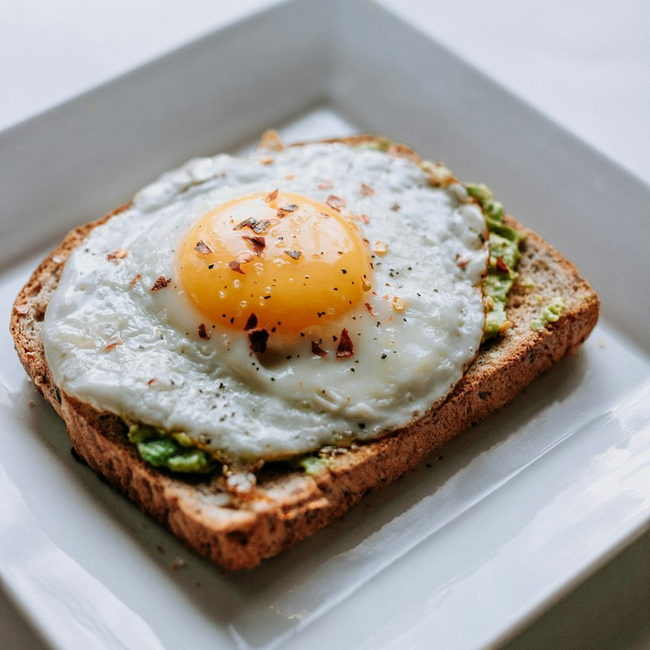
* **Địa chỉ:** 36 Đường Số 18, Phường 8, Quận Gò Vấp, TP.HCM
* **Hotline:** 093 782 54 44
* **Món chính / Must-try:** Bánh mì chảo thập cẩm (pate, xíu mại, ốp la, xúc xích, phô mai), Bánh mì bò xào, Sữa đậu nành
* **Giá cả:** 25.000 - 45.000 VNĐ
* **Đánh giá & Điểm nổi bật:** Quán bánh mì chảo đông nức tiếng Gò Vấp với hàng nghìn lượt đánh giá thật; chảo sốt cà chua thịt băm sánh sệt đậm đà, pate nhà làm béo ngậy không ngấy, bánh mì lúc nào cũng nóng giòn rụm.
* **Nguồn review & Link bài viết:** [Review cộng đồng Gò Vấp / Foody](https://www.foody.vn/ho-chi-minh/banh-mi-chao-co-3-hau)
* **Tags:** `#Gò Vấp`, `#Bánh mì chảo`, `#Cô 3 Hậu`, `#Đường số 18`, `#Đông khách`, `#Ăn sáng`

---

## 17. Nhà Hàng Ẩm Thực Những Người Bạn (Gò Vấp)
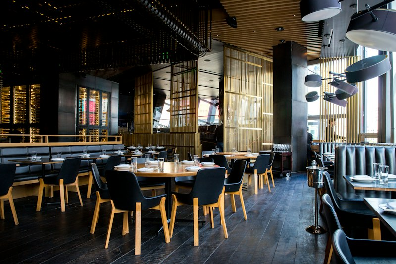
* **Địa chỉ:** 14 Phan Văn Trị, Phường 7, Quận Gò Vấp, TP.HCM
* **Hotline:** 028 3588 5888
* **Món chính / Must-try:** Heo tộc quay lu mẹt, Cá lăng nướng muối ớt / nấu măng chua, Gà ta hấp mắm nhĩ, Lẩu riêu cua bắp bò
* **Giá cả:** 150.000 - 350.000 VNĐ
* **Đánh giá & Điểm nổi bật:** Nhà hàng sân vườn quy mô lớn và uy tín bậc nhất Gò Vấp (>4.000 đánh giá Google Maps ~4.5 sao); không gian rợp cây xanh thoáng đãng, hải sản và đặc sản đồng quê tươi rói, chế biến ngon miệng và ổn định lâu năm.
* **Nguồn review & Link bài viết:** [Google Maps / Đánh giá ẩm thực Sài Gòn](https://www.foody.vn/ho-chi-minh/nhung-nguoi-ban-am-thuc-san-vuon)
* **Tags:** `#Gò Vấp`, `#Ẩm thực sân vườn`, `#Gia đình`, `#Họp mặt`, `#Phan Văn Trị`, `#Hải sản`

---

## 18. Gà Nướng Cái Bang (Quang Trung) (Gò Vấp)
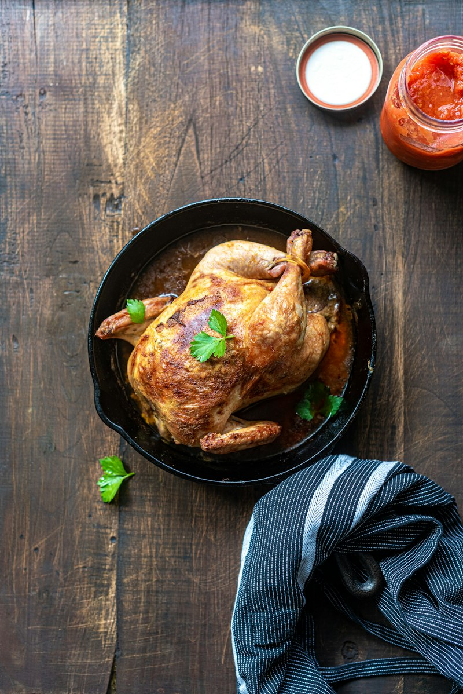
* **Địa chỉ:** 181 Quang Trung, Phường 10, Quận Gò Vấp, TP.HCM
* **Hotline:** 090 988 51 68
* **Món chính / Must-try:** Gà nướng muối ớt xanh, Gà nướng ngũ vị, Xôi chiên phồng giòn, Chân gà quái thú
* **Giá cả:** 120.000 - 220.000 VNĐ / con
* **Đánh giá & Điểm nổi bật:** Thương hiệu gà nướng phong cách cổ trang cực kỳ đông khách; thịt gà ta thả vườn dai ngọt nướng vàng óng da giòn, sốt ướp thấm sâu vào từng thớ thịt, chấm muối ớt xanh chua cay bắt vị.
* **Nguồn review & Link bài viết:** [Review ẩm thực thực tế](https://www.foody.vn/ho-chi-minh/ga-nuong-cai-bang-quang-trung)
* **Tags:** `#Gò Vấp`, `#Gà nướng`, `#Cái Bang`, `#Quang Trung`, `#Tụ tập bạn bè`

---

## 19. Bánh Cuốn Tây Sơn Cô 2 (Đặc Sản Bình Định) (Gò Vấp)
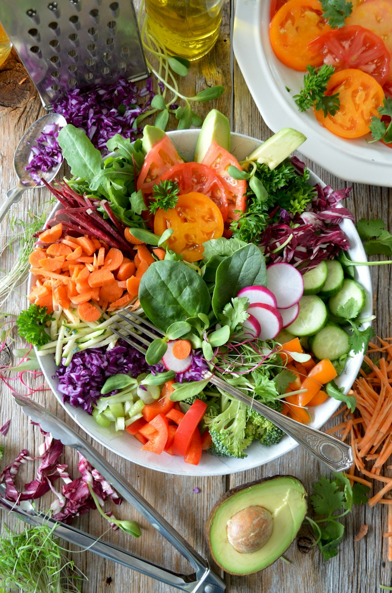
* **Địa chỉ:** 346 Nguyễn Thái Sơn, Phường 5, Quận Gò Vấp, TP.HCM
* **Hotline:** 090 912 34 56
* **Món chính / Must-try:** Bánh cuốn Tây Sơn cỡ đại (chả ram giòn, nem chua, trứng, thịt lụi), Bánh bèo chén Bình Định, Chả ram tôm đất
* **Giá cả:** 15.000 - 35.000 VNĐ
* **Đánh giá & Điểm nổi bật:** Quán vỉa hè lúc nào cũng đông nghẹt khách; bánh cuốn to đùng gói chả ram giòn rụm bên trong, chấm cùng nước sốt đậu phộng thịt xay béo bùi chuẩn vị xứ võ Tây Sơn.
* **Nguồn review & Link bài viết:** [Review ẩm thực đường phố / MXH](https://www.foody.vn/ho-chi-minh/banh-cuon-tay-son-co-2)
* **Tags:** `#Gò Vấp`, `#Bánh cuốn Tây Sơn`, `#Nguyễn Thái Sơn`, `#Đặc sản Bình Định`, `#Bình dân`

---

## 20. Dalatown - Bánh Căn & Bánh Tráng Nướng Đà Lạt (Gò Vấp)
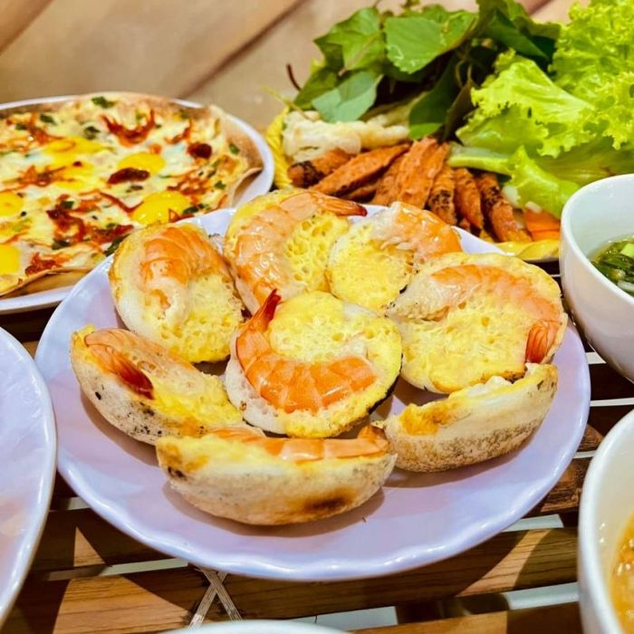
* **Địa chỉ:** 448 Lê Văn Thọ, Phường 16, Quận Gò Vấp, TP.HCM
* **Hotline:** 0985 796 948
* **Món chính / Must-try:** Bánh căn trứng cút lòng đào xíu mại, Bánh căn trứng gà, Bánh tráng nướng Đà Lạt giòn rụm, Nem nướng & Trà atiso
* **Giá cả:** 30.000 - 65.000 VNĐ
* **Đánh giá & Điểm nổi bật:** Góc ẩm thực mang trọn không khí và phong vị Đà Lạt về Gò Vấp. Bánh căn đổ khuôn đất giòn rụm vỏ ngoài mềm xốp bên trong ăn cùng chén xíu mại bốc khói béo bùi, nước mắm nêm thanh dịu hoặc mắm ngọt tự chọn cực kỳ cuốn.
* **Nguồn review & Link bài viết:** [Threads & Tripi Review (Top Bánh Căn Sài Gòn)](https://tripi.vn/blog/vi/xep-hang/14-dia-chi-banh-can-dam-vi-niu-chan-thuc-khach-tai-sai-gon-tripi)
* **Tags:** `#Gò Vấp`, `#Bánh căn`, `#Đà Lạt`, `#Bánh tráng nướng`, `#Xíu mại`, `#Ăn vặt`, `#Lê Văn Thọ`

---

## 21. Bún Cay Thái 2 Thuận - Nguyễn Văn Khối (Gò Vấp)
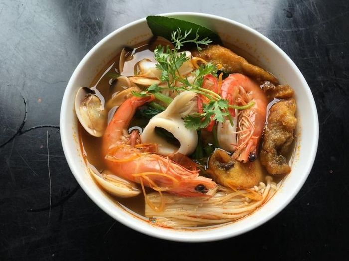
* **Địa chỉ:** 320 Nguyễn Văn Khối (Cây Trâm cũ), Phường 9, Quận Gò Vấp, TP.HCM
* **Hotline:** 0929 233 114
* **Món chính / Must-try:** Bún Thái chua cay hải sản thập cẩm, Bún hải sản mực giòn tôm sú bò Mỹ, Trà tắc giải nhiệt khổng lồ
* **Giá cả:** 35.000 - 55.000 VNĐ
* **Đánh giá & Điểm nổi bật:** Tô bún Thái chua cay nóng hổi đậm đà hương sả lá chanh với nước dùng ngọt thanh từ xương tôm. Topping hào phóng ngập tràn tôm sú tươi ngọt, mực giòn sần sật và thịt bò mềm, cực kỳ bắt vị trong những ngày mưa mát mẻ.
* **Nguồn review & Link bài viết:** [Threads, Lemon8 & Tripi/LUG Review](https://tripi.vn/blog/vi/am-thuc/9-diem-den-bun-hai-san-ngon-binh-dan-khong-the-bo-qua-tai-sai-gon-tripi)
* **Tags:** `#Gò Vấp`, `#Bún Thái`, `#Bún cay`, `#Hải sản`, `#Nguyễn Văn Khối`, `#Bình dân`

---

## 22. Bếp Ông Lập - Bún Bò Thố Đá & Bò Kho Xuyên Tiêu (Gò Vấp)
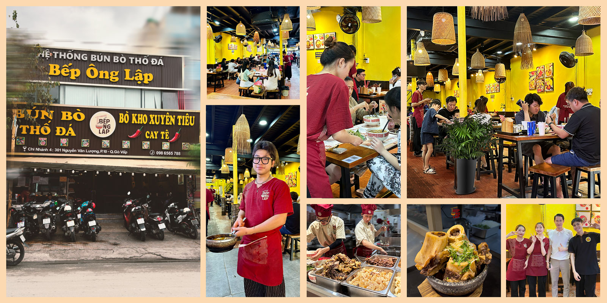
* **Địa chỉ:** 301 Nguyễn Văn Lượng, Phường 10, Quận Gò Vấp, TP.HCM
* **Hotline:** 0986 565 788 / 1900 999 973
* **Món chính / Must-try:** Bún bò thố đá sườn sụn / đuôi bò, Bún bò đặc biệt thố đá, Bò kho xuyên tiêu cay nồng, Lẩu bò nhúng mắm ruốc
* **Giá cả:** 45.000 - 85.000 VNĐ
* **Đánh giá & Điểm nổi bật:** Quán bún bò thố đá trứ danh cực đông khách tại Gò Vấp; nước dùng đựng trong thố đá sôi sùng sục giữ nóng hổi đến giọt cuối cùng, nước hầm thanh ngọt tự nhiên, thịt bắp bò mềm ngậy ăn kèm mắm ruốc chấm pha riêng thơm nức mũi.
* **Nguồn review & Link bài viết:** [Bếp Ông Lập & MXH Ẩm Thực](https://beponglap.vn/bep-ong-lap-chieu-dai-thuc-khach-mon-bun-bo-tho-da-tru-danh-va-bo-kho-xuyen-tieu-gay-nghien-tai-go-vap)
* **Tags:** `#Gò Vấp`, `#Bún bò thố đá`, `#Bếp Ông Lập`, `#Nguyễn Văn Lượng`, `#Ăn sáng`, `#Ăn trưa`, `#Ăn tối`

---

## 23. GAPHUNG JUMAK - Korean Pub & Quán Ăn Hàn Quốc (가풍주막) (Gò Vấp)
* **Địa chỉ:** 113 Nguyễn Văn Lượng, Phường 17, Quận Gò Vấp, TP.HCM
* **Hotline:** 038 219 8676
* **Món chính / Must-try:** Bánh xèo Hàn Quốc giòn rụm (Kimchijeon / Pajeon), Canh kim chi thịt heo hầm (Kimchi Jjigae), Gà sốt tỏi cay ngọt, Rượu gạo Makgeolli & Soju
* **Giá cả:** 60.000 - 180.000 VNĐ
* **Đánh giá & Điểm nổi bật:** Không gian pub nhậu chuẩn Hàn ấm cúng do chính chủ người Hàn đứng bếp tại Gò Vấp; món ăn chuẩn vị nguyên bản không bị lai ngọt, panchan đầy đặn, cực kỳ lý tưởng để họp mặt bạn bè lai rai buổi tối.
* **Nguồn review & Link bài viết:** [Threads & Review Ẩm Thực Sài Gòn (Mecrawl / LocalVietnam)](https://mecrawl.com/en/places/go-vaps-quiet-korean-star-inside-gaphung-jumak-a_01m2d8caepvvcexvtefzw85w4k)
* **Tags:** `#Gò Vấp`, `#Món Hàn`, `#Korean Pub`, `#Gaphung Jumak`, `#Nguyễn Văn Lượng`, `#Ăn tối`, `#Tụ tập bạn bè`

---
